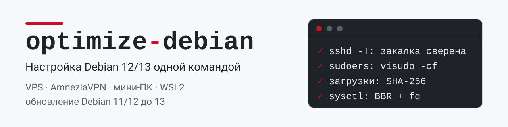
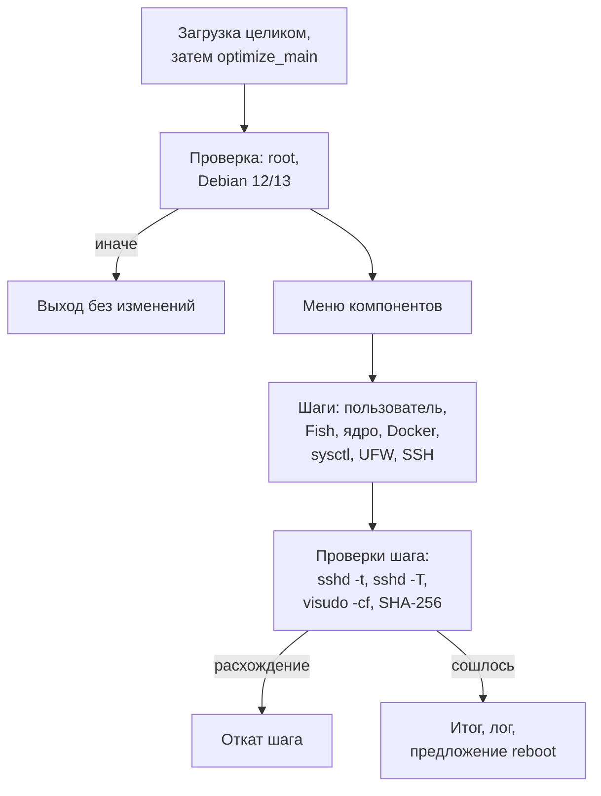

<p align="center">
  <picture>
    <source media="(prefers-color-scheme: dark)" srcset="docs/assets/banner-dark.svg">
    
  </picture>
</p>

<p align="center">
  <a href="https://github.com/snaplyze/optimize-debian/actions/workflows/ci.yml"></a>
  <a href="https://github.com/snaplyze/optimize-debian/releases/latest"></a>
  <a href="LICENSE"></a>
  <a href="docs/README.md"></a>
</p>

Bash-скрипты, которые настраивают чистую Debian 12/13 под VPS, хост AmneziaVPN, мини-ПК Intel N5095 и WSL2 и обновляют Debian 11/12 до 13. Каждый скрипт — один файл: его запускают от root на целевой машине одной командой, а что именно он меняет, описано в руководстве.

[Какой скрипт выбрать](#какой-скрипт-выбрать) · [Быстрый старт](#быстрый-старт) · [Как работает скрипт](#как-работает-скрипт) · [Возможности](#возможности) · [Безопасность](#безопасность) · [Версии и выпуски](#версии-и-выпуски) · [Документация](#документация) · [Решение частых проблем](#решение-частых-проблем) · [Участие в разработке](#участие-в-разработке) · [Лицензия](#лицензия)

## Какой скрипт выбрать

| Скрипт | Для чего | Debian | Версия скрипта | Руководство |
|---|---|---|---|---|
| `optimize_vps.sh` | VPN-сервер на VPS с 1–4 GB RAM: ядро Debian Backports, sysctl под 10 Гбит/с, Fish + Starship, Go, Node.js/fnm, Docker, закалка SSH, Fail2Ban, UFW | 12, 13 | 3.0.0 | [руководство](docs/README_VPS.md) |
| `optimize_amnezia_host.sh` | Хост под AmneziaVPN self-hosted: только база для приложения Amnezia, параметры флагами, firewall в две фазы | 12, 13 | 0.3.0 | [руководство](docs/README_AMNEZIA_HOST.md) |
| `optimize_mini_pc.sh` | Домашний и медиасервер на Intel N5095: ядро Debian Backports, Intel QuickSync, Samba, Docker, Fish + Starship | 12, 13 | 2.0.0 | [руководство](docs/README_MINI_PC.md) |
| `optimize_wsl2.sh` | WSL2 для разработки и ML: systemd в `wsl.conf`, Fish + Starship, Go, Node.js/fnm, Docker, NVIDIA Container Toolkit и CUDA | 12, 13 | 4.1.0 | [руководство](docs/README_WSL2.md) |
| `upgrade-to-debian13.sh` | Обновление серверной Debian до 13 с бэкапом и проверкой SSH после каждого шага; не для WSL2 | 11, 12 | 2.0.3 | [руководство](docs/README_UPGRADE.md) |

Версия скрипта — значение `SCRIPT_VERSION` в его коде; `bash <скрипт> --help` печатает ее без root. Четыре `optimize_*.sh` при запуске проверяют версию Debian и на любой другой завершаются сразу.

Все `optimize_*.sh` при настройке локалей генерируют `en_US.UTF-8` и `ru_RU.UTF-8`, чтобы SSH-сессии с английским или русским окружением работали без предупреждений `setlocale`. Amnezia-профиль делает это автоматически, сохраняя системный язык; в Mini PC и WSL2 шаг можно отключить. Выбор языка в VPS, Mini PC и WSL2 задает значение по умолчанию через `update-locale`, без постоянного `LC_ALL`. Для уже настроенного сервера см. [исправление ошибки локали](docs/README_AMNEZIA_HOST.md#ошибка-setlocale-при-входе-по-ssh).

## Быстрый старт

> [!WARNING]
> Скрипты меняют ядро, пользователей, sudoers, SSH, firewall и sysctl. Запускайте их только на целевой машине от root; на рабочей станции не запускайте ни от root, ни через `sudo`. Перед запуском сделайте снимок VM или бэкап. `bash <скрипт> --help` печатает справку без root и ничего не меняет.

Команды ниже запускают текущую версию из `main`. `curl -fsSL` останавливается на ошибке HTTP, а шаги `optimize_vps.sh`, `optimize_mini_pc.sh` и `optimize_wsl2.sh` начинаются только после того, как скрипт загружен целиком: оборванная загрузка ничего не меняет.

> [!TIP]
> Чтобы запустить закрепленный выпуск, замените в адресе `main` на его тег (см. [Версии и выпуски](#версии-и-выпуски)).

### VPS

```bash
# Быстрый запуск (bash + curl)
bash <(curl -fsSL https://raw.githubusercontent.com/snaplyze/optimize-debian/main/optimize_vps.sh)

# Или скачайте и запустите
wget https://raw.githubusercontent.com/snaplyze/optimize-debian/main/optimize_vps.sh
chmod +x optimize_vps.sh
sudo ./optimize_vps.sh
```

### AmneziaVPN host

```bash
# Целевой пользователь: без --user это пользователь, запустивший sudo (SUDO_USER);
# от root без sudo --user обязателен (root как целевой пользователь не допускается).
# Задайте имя оператора один раз (замените ops на свое):
OPERATOR=ops

# Быстрый запуск (bash + curl, под root)
bash <(curl -fsSL https://raw.githubusercontent.com/snaplyze/optimize-debian/main/optimize_amnezia_host.sh) --user "$OPERATOR" --yes

# Или скачайте и запустите минимальный host baseline
wget https://raw.githubusercontent.com/snaplyze/optimize-debian/main/optimize_amnezia_host.sh
chmod +x optimize_amnezia_host.sh

# Рекомендуемый путь: подготовить host и сразу поставить vanilla Docker CE
sudo ./optimize_amnezia_host.sh --yes

# Если пользователя нет, его можно создать сразу
sudo ./optimize_amnezia_host.sh --user "$OPERATOR" --create-user \
  --ssh-public-key 'ssh-ed25519 AAAA... your-key' --yes

# Если swap уже настроен отдельно, можно пропустить его создание
sudo ./optimize_amnezia_host.sh --skip-swap --yes

# Альтернатива: оставить установку Docker самому приложению Amnezia
sudo ./optimize_amnezia_host.sh --skip-docker --yes

# После того как AmneziaWG закреплен на 8443/udp, можно ужесточить firewall
sudo ./optimize_amnezia_host.sh --firewall-phase locked --yes
```

### Mini PC

```bash
# Быстрый запуск (bash + curl)
bash <(curl -fsSL https://raw.githubusercontent.com/snaplyze/optimize-debian/main/optimize_mini_pc.sh)

# Или скачайте и запустите
wget https://raw.githubusercontent.com/snaplyze/optimize-debian/main/optimize_mini_pc.sh
chmod +x optimize_mini_pc.sh
sudo ./optimize_mini_pc.sh
```

### WSL2

```bash
# Только Debian 12 или Debian 13 под WSL2

# Подготовка в Windows PowerShell
wsl --update
wsl --set-default-version 2

# Быстрый запуск (bash + curl)
bash <(curl -fsSL https://raw.githubusercontent.com/snaplyze/optimize-debian/main/optimize_wsl2.sh)

# Или скачайте и запустите в WSL2
wget https://raw.githubusercontent.com/snaplyze/optimize-debian/main/optimize_wsl2.sh
chmod +x optimize_wsl2.sh
sudo ./optimize_wsl2.sh
```

### Обновление Debian 11/12 до 13

```bash
# Быстрый запуск (bash + curl)
bash <(curl -fsSL https://raw.githubusercontent.com/snaplyze/optimize-debian/main/upgrade-to-debian13.sh)

# Или скачайте и запустите интерактивный апгрейд
wget https://raw.githubusercontent.com/snaplyze/optimize-debian/main/upgrade-to-debian13.sh
chmod +x upgrade-to-debian13.sh
sudo ./upgrade-to-debian13.sh

# Или без интерактивных подтверждений.
# Для Debian 11 скрипт остановится после 11 -> 12, чтобы дать сделать reboot.
sudo ./upgrade-to-debian13.sh --yes

# Только для лабораторных стендов: разрешить 11 -> 12 -> 13 без промежуточного reboot
sudo ./upgrade-to-debian13.sh --yes --allow-two-hop-no-reboot
```

## Как работает скрипт



Так работают `optimize_mini_pc.sh` и `optimize_wsl2.sh` (WSL2 дополнительно проверяет, что это WSL; ядра, swap, UFW, Fail2Ban и закалки SSH у него нет — какие шаги есть у каждого скрипта, см. [Возможности](#возможности)). `optimize_vps.sh` меню компонентов не показывает: он спрашивает имя пользователя, ключ SSH, имя хоста, локаль и часовой пояс, ждет Enter после проверки входа по SSH, остальные шаги идут все. `optimize_amnezia_host.sh` берет параметры из флагов, подтверждает запуск (без `--yes`) и выполняет один фиксированный проход `main`. `upgrade-to-debian13.sh` идет своим маршрутом: проверки, бэкап в `/root/upgrade-backup-<TS>/`, шаги `11 -> 12` и `12 -> 13` с проверкой `sshd -t` и портов SSH после каждого, лог в `/var/log/debian-upgrade/`.

TUI: основной backend — Charmbracelet `gum`; если его нет, он скачивается с проверкой SHA-256, а при неудаче используется plain Bash prompt. `dialog` и `whiptail` не выбираются автоматически и доступны только через явный `TUI_BACKEND=dialog|whiptail`.

## Возможности

| Возможность | VPS | Amnezia | Mini PC | WSL2 |
|---|:---:|:---:|:---:|:---:|
| Ядро Debian Backports на Debian 12 | ✅ | ✅ `--kernel-backports` | ✅ | — |
| Fish + Starship (`nerd-font-symbols`), `/bin/bash` остается login shell | ✅ | ✅ | ✅ | ✅ |
| sysctl: BBR + fq, Loose `rp_filter = 2` | ✅ | ✅ | ✅ | ✅ |
| Буферы `rmem_max`/`wmem_max` | до 64 MB | 32–64 MB | 32 MB | 64 MB |
| Docker CE + Compose plugin | ✅ | ✅ vanilla | ✅ | ✅ |
| Закалка SSH: drop-in `00-*.conf`, проверка `sshd -T` | ✅ | ✅ | ✅ | — |
| Fail2Ban (`backend = systemd`, `python3-systemd`) | ✅ | ✅ | ✅ | — |
| UFW | ✅ | ✅ две фазы | ✅ | — |
| UFW: `DEFAULT_FORWARD_POLICY="ACCEPT"` для VPN | ✅ | ✅ | — | — |
| Swap-файл | по RAM | 2 GB | 4 GB при 12 GB+ RAM | — |
| Синхронизация времени (существующий NTP или `systemd-timesyncd`) | ✅ | ✅ | ✅ | — |
| Локали `en_US.UTF-8` + `ru_RU.UTF-8` | ✅ | ✅ | ✅ | ✅ |
| Автообновления безопасности (`unattended-upgrades`) | ✅ | — | ✅ | ✅ |
| CPU governor `schedutil` | ✅ | — | ✅ | — |
| Go (закрепленная версия, SHA-256) | ✅ | — | ✅ | ✅ |
| Node.js LTS через fnm | ✅ | — | ✅ | ✅ |
| NVIDIA Container Toolkit + CUDA (`cuda-keyring`) | — | — | — | ✅ |
| Intel QuickSync (`intel-media-va-driver-non-free`, `vainfo`) | — | — | ✅ | — |
| Samba (`server min protocol = SMB2`) | — | — | ✅ по выбору | — |
| Служебные скрипты (monitor, cleanup; info — VPS и Mini PC, backup — WSL2) | ✅ | — | ✅ | ✅ |

Что ставит и настраивает каждый шаг, какие файлы пишет и как это откатить — в руководствах из раздела [Документация](#документация).

## Безопасность

- Закалка SSH пишется в drop-in `/etc/ssh/sshd_config.d/00-*.conf`: sshd берет первое прочитанное значение, поэтому `50-cloud-init.conf` с `PasswordAuthentication yes` ее не отменяет. После `sshd -t` действующие значения сверяются через `sshd -T`; при расхождении drop-in снимается и sshd не перезапускается.
- Файлы `/etc/sudoers.d/*` пишутся через временный файл с проверкой `visudo -cf`; при ошибке прежний файл остается без изменений.
- Starship 1.27.0 (на Debian 13 — пакет `starship` из Debian), fnm 1.39.0, Go 1.27.3, gum 0.17.0 и `cuda-keyring` 1.1-1 закреплены по версии и SHA-256, записанной в скрипте; при несовпадении установка отклоняется. Исключение — Node.js: текущий LTS ставит fnm с nodejs.org по HTTPS, версия и сумма в репозитории не закреплены.
- Ключи репозиториев Docker и NVIDIA Container Toolkit принимаются только с закрепленным отпечатком основного ключа.
- Загрузки идут только по HTTPS (и при редиректах): каждая попытка — не дольше 15 минут (gum — 5), повторы начинаются только в пределах этого же времени, так что загрузка завершается не позже чем примерно через 30 минут (gum — 10). Временные файлы — в уникальных каталогах `mktemp -d`, которые удаляются после установки, при ошибке и при выходе скрипта, в том числе по сигналу.
- `upgrade-to-debian13.sh` сохраняет `/etc/ssh`, `authorized_keys` и состояние firewall в `/root/upgrade-backup-<TS>/`, защищает пакеты удаленного доступа от `autoremove` и после каждого шага проверяет `sshd` и прослушивание прежних портов.

Об уязвимости сообщайте приватно, как описано в [SECURITY.md](SECURITY.md), а не через публичный issue.

## Версии и выпуски

- `main` — текущая версия. В него попадают только PR, прошедшие проверку `checks`, и команды этого README запускают именно его.
- Выпуск — снимок всех скриптов с тегом `vГГГГ.ММ.ДД` (второй выпуск за день — `vГГГГ.ММ.ДД.1`) и списком изменений на странице [Releases](https://github.com/snaplyze/optimize-debian/releases). Выпуски неизменяемы, а теги `v*` нельзя перенести или удалить, поэтому команда с тегом всегда запускает один и тот же код.
- Если версия из `main` повела себя не так, запустите предыдущий выпуск: замените `main` в адресе на его тег.

```bash
TAG=v2026.10.21.1   # последний выпуск: https://github.com/snaplyze/optimize-debian/releases/latest
bash <(curl -fsSL "https://raw.githubusercontent.com/snaplyze/optimize-debian/$TAG/optimize_vps.sh")
```

Версии в заголовках скриптов (например, WSL2 4.1.0) относятся к отдельному скрипту, а тег выпуска — ко всему репозиторию. История изменений — в [CHANGELOG.md](CHANGELOG.md).

### Обновление

```bash
# Текущая версия из main; чтобы скачать выпуск, замените main на его тег
curl -fsSLO https://raw.githubusercontent.com/snaplyze/optimize-debian/main/optimize_amnezia_host.sh
curl -fsSLO https://raw.githubusercontent.com/snaplyze/optimize-debian/main/optimize_vps.sh
curl -fsSLO https://raw.githubusercontent.com/snaplyze/optimize-debian/main/optimize_mini_pc.sh
curl -fsSLO https://raw.githubusercontent.com/snaplyze/optimize-debian/main/optimize_wsl2.sh
curl -fsSLO https://raw.githubusercontent.com/snaplyze/optimize-debian/main/upgrade-to-debian13.sh
```

## Документация

- [docs/README.md](docs/README.md) — оглавление документации.
- [docs/README_VPS.md](docs/README_VPS.md) — VPS: `optimize_vps.sh`.
- [docs/README_AMNEZIA_HOST.md](docs/README_AMNEZIA_HOST.md) — хост AmneziaVPN: `optimize_amnezia_host.sh`.
- [docs/README_MINI_PC.md](docs/README_MINI_PC.md) — мини-ПК Intel N5095: `optimize_mini_pc.sh`.
- [docs/README_WSL2.md](docs/README_WSL2.md) — WSL2: `optimize_wsl2.sh`.
- [docs/README_UPGRADE.md](docs/README_UPGRADE.md) — обновление Debian 11/12 до 13: `upgrade-to-debian13.sh`.
- [docs/ARCHITECTURE.md](docs/ARCHITECTURE.md) — устройство репозитория: встроенные копии `lib/`, `optimize_main`, тесты, CI, выпуски.
- [CHANGELOG.md](CHANGELOG.md) — выпуски и история версий скриптов.

## Решение частых проблем

<details>
<summary>Ошибка терминала VSCode Remote: <code>__vsc_update_env</code></summary>

При использовании VSCode Remote (WSL/SSH/Tunnels) может появиться ошибка:

```
__vsc_update_env:6: key: attempt to set associative array to scalar
```

Скрипты решают это сами: переход на Fish shell и чистый `.bashrc` устраняет конфликты `__vsc_update_env`. Если ошибка осталась, закройте все старые терминалы в VSCode и откройте новый (`Ctrl + ~`).

</details>

<details>
<summary>npm EACCES при установке глобальных пакетов</summary>

Скрипты ставят fnm в каталог пользователя, поэтому права доступа остаются корректными. Реализация рассчитана на чистую ОС и не переносит уже существующие конфигурации NVM.

Ручное исправление, если нужно:

```bash
sudo chown -R $(whoami):$(whoami) ~/.npm
sudo chown -R $(whoami):$(whoami) ~/.local/share/fnm
sudo chown -R $(whoami):$(whoami) ~/.config
```

</details>

<details>
<summary>WSL2: CUDA, contrib и вывод сведений о системе</summary>

`optimize_wsl2.sh` работает только на Debian 12 и 13 под WSL2. Путь репозитория CUDA выбирается по `VERSION_ID`: `debian12` или `debian13`. Пакет `cuda-keyring` ставится официальным методом NVIDIA, а его SHA-256 сверяется с суммой, закрепленной в скрипте; широкий метапакет `cuda` в WSL не используется. Go и Node.js/fnm включаются отдельными пунктами меню; `apt-transport-https` не требуется.

Что делает скрипт для CUDA, по шагам:

```bash
# Включение contrib (обязательно для Debian)
add-apt-repository contrib

# Установка keyring пакета (рекомендовано NVIDIA); скрипт сверяет его SHA-256
# с суммой, закрепленной для debian12 или debian13, и только затем устанавливает
curl -fsSL -o cuda-keyring_1.1-1_all.deb https://developer.download.nvidia.com/compute/cuda/repos/debian${VERSION_ID}/x86_64/cuda-keyring_1.1-1_all.deb
dpkg -i cuda-keyring_1.1-1_all.deb

# Установка CUDA
apt update
apt install cuda-toolkit
```

Сведения о системе: скрипт сначала пытается использовать `fastfetch`, затем `neofetch`, а если ни один пакет недоступен — пропускает этот шаг без ошибки. `fastfetch` предпочтителен: написан на C, активно поддерживается, гибче настраивается и официально доступен в Debian 13.

</details>

<details>
<summary>Обновление до Debian 13 на облачной VM</summary>

`upgrade-to-debian13.sh` не переписывает настройку сети под конкретный cloud image. Ошибки вида `networking.service failed` после перезагрузки могут быть особенностью образа или VM, а не самого обновления; разбор идет на уровне VM (serial console, восстановление из `/root/upgrade-backup-*`). Подробнее — в [docs/README_UPGRADE.md](docs/README_UPGRADE.md).

</details>

## Участие в разработке

Вопросы и ошибки — через [issues](https://github.com/snaplyze/optimize-debian/issues), уязвимости — по [SECURITY.md](SECURITY.md). Правила изменений, коммитов и PR — в [CONTRIBUTING.md](CONTRIBUTING.md), устройство репозитория — в [docs/ARCHITECTURE.md](docs/ARCHITECTURE.md). Проверка перед PR, из корня репозитория и не от root:

```bash
for f in *.sh lib/*.sh tests/*.sh; do bash -n "$f" || echo "FAIL: $f"; done
shellcheck -- *.sh lib/*.sh tests/*.sh
for test in tests/*.sh; do bash "$test" || echo "FAIL: $test"; done
```

`bash -n` проверяет только первый переданный файл, поэтому синтаксис проверяется по одному файлу. Те же проверки выполняет CI (`.github/workflows/ci.yml`) на self-hosted раннере для push в `main` и PR владельца из этого же репозитория; для других источников проверка `checks` падает на GitHub-hosted раннере, не исполняя их код. Запуски из форков требуют одобрения владельца — не одобряйте их: PR из форка исполняет свой вариант workflow. Вклад из форка владелец проверяет, перенеся его в ветку этого репозитория.

Каждый `optimize_*.sh` работает одним файлом: `lib/common.sh` и `lib/tui.sh` подключаются, только если лежат рядом, иначе работают встроенные копии нужных функций. Изменение функции в `lib/` повторяется в копиях каждого скрипта; совпадение проверяет `tests/test_embedded_copies.sh`.

## Лицензия

MIT, см. [LICENSE](LICENSE).
