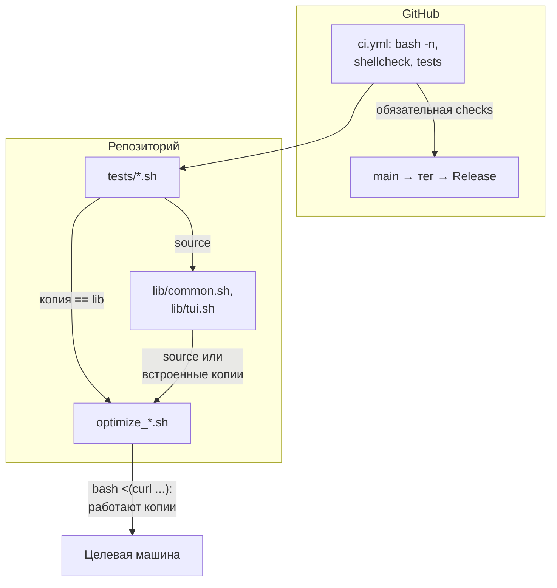

# Устройство репозитория

[README](../README.md) · [Вся документация](README.md)

Как устроены скрипты, библиотека `lib/`, тесты, CI и выпуски. Для участников: правила вклада (проверки перед PR, коммиты, PR, форки) описаны в [CONTRIBUTING.md](../CONTRIBUTING.md), правила репозитория — в [AGENTS.md](../AGENTS.md). Все факты ниже взяты из кода; при расхождении прав код.

## Содержание

- [Структура каталогов](#структура-каталогов)
- [Как связаны скрипты, lib, тесты и CI](#как-связаны-скрипты-lib-тесты-и-ci)
- [Анатомия optimize_vps.sh, optimize_mini_pc.sh и optimize_wsl2.sh](#анатомия-optimize_vpssh-optimize_mini_pcsh-и-optimize_wsl2sh)
- [Чем отличаются optimize_amnezia_host.sh и upgrade-to-debian13.sh](#чем-отличаются-optimize_amnezia_hostsh-и-upgrade-to-debian13sh)
- [lib/common.sh](#libcommonsh)
- [lib/tui.sh](#libtuish)
- [Шаблоны безопасности](#шаблоны-безопасности)
- [Тесты](#тесты)
- [CI](#ci)
- [Выпуски](#выпуски)

## Структура каталогов

| Путь | Что это |
|---|---|
| `optimize_vps.sh`, `optimize_amnezia_host.sh`, `optimize_mini_pc.sh`, `optimize_wsl2.sh` | Скрипты настройки Debian 12/13; каждый работает одним файлом |
| `upgrade-to-debian13.sh` | Обновление Debian 11/12 до 13; от `lib/` не зависит |
| `lib/common.sh` | Общие функции `common_*`: deb822, APT, пользователи и sudoers, время, временные каталоги, закрепленные загрузки, Fish и Bash, SSH |
| `lib/tui.sh` | Функции `tui_*`: установка `gum`, выбор backend, вопросы и списки |
| `tests/*.sh` | Тесты на Bash, по одному файлу на тему; запускаются без root |
| `docs/` | Руководства по скриптам, это описание, `plan.md` (реестр задач) |
| `.github/workflows/ci.yml` | Задание `checks`: синтаксис, shellcheck, тесты |
| `.github/shellcheck.txt` | Закрепленный релиз shellcheck и SHA-256 его архива для CI |
| `README.md`, `AGENTS.md`, `CLAUDE.md` | Обзор для пользователей; правила репозитория; `CLAUDE.md` подключает `AGENTS.md` |
| `.gitattributes` | `*.sh` и `*.md` всегда с LF |

Артефактов сборки нет. Логи скрипты пишут на целевой машине в `/var/log/` и в репозиторий не попадают.

## Как связаны скрипты, lib, тесты и CI



Пользователь запускает скрипт как `bash <(curl -fsSL .../main/<script>.sh)`: рядом нет `lib/`, поэтому в каждом `optimize_*.sh` лежат копии нужных ему функций `lib/`. Единственная реализация — в `lib/`; тесты проверяют `lib/`, а `tests/test_embedded_copies.sh` проверяет, что каждая копия совпадает с `lib/` байт в байт. Изменил функцию в `lib/` — измени ее копии во всех скриптах, где она есть.

## Анатомия optimize_vps.sh, optimize_mini_pc.sh и optimize_wsl2.sh

Сверху вниз (на примере `optimize_vps.sh`):

1. **Заголовок.** `#!/bin/bash`, `export LC_ALL=C` и `LANG=C`, `set -e` (`optimize_wsl2.sh`: `set -Eeuo pipefail`), цвета, `LOG_FILE` (`/var/log/vps_optimization.log`). `SCRIPT_VERSION` (VPS 3.0.0, mini-PC 2.0.0, WSL2 4.1.0) печатает `--help`; `tests/test_repository_hygiene.sh` сверяет его с таблицей «Какой скрипт выбрать» в README.
2. **`SCRIPT_DIR`.** Каталог скрипта через `readlink -f "${BASH_SOURCE[0]}"`; если каталога нет (запуск из `<(curl ...)`), берется `pwd -P`.
3. **Подключение `lib/`.** `source "$SCRIPT_DIR/lib/common.sh"` и `source "$SCRIPT_DIR/lib/tui.sh"`, только если файл читается (сразу после `SCRIPT_DIR`).
4. **Встроенные копии.** Группы вида `if ! declare -F <первая функция группы> >/dev/null; then ... fi` сразу за подключением `lib/` (в VPS это около 1500 строк, последняя группа — `tui_detect_backend`): если `lib/` подключен, копии не определяются; если нет — определяются. Групп: VPS 9, mini-PC 9, WSL2 7, Amnezia 6. Тела функций в копиях совпадают с `lib/`; сдвигать отступы heredoc внутри них нельзя — изменится текст, который они пишут.
5. **Помощники вывода.** `log`, `warn`, `error`, `info`, `progress`, `section` (после копий `lib/`) определяет скрипт, не `lib/`: функции `lib/` зовут их и рассчитывают, что они есть.
6. **`print_usage` и `optimize_main`.** Все шаги лежат в теле `optimize_main()`, тело оставлено в колонке верхнего уровня, чтобы heredoc-шаблоны не сдвигались. Первое, что делает `optimize_main`: `case "${1:-}"` — `-h|--help` печатает справку и выходит с кодом 0 (без root и без изменений), пустой аргумент пропускается, любой другой — `Unknown argument`, код 2. Затем проверка root (`exit 1`).
7. **Хвост файла.** `if [[ "${OPTIMIZE_SOURCE_ONLY:-0}" == "1" ]]; then return 0 2>/dev/null || exit 0; fi` и последней строкой `optimize_main "$@"`. С `OPTIMIZE_SOURCE_ONLY=1` файл можно `source` без запуска шагов — так его загружают тесты. Поскольку bash читает функцию целиком до выполнения, оборванная загрузка (`bash <(curl ...)` при обрыве сети) заканчивается синтаксической ошибкой раньше, чем до вызова `optimize_main`, и ничего не меняет; это проверяет `tests/test_truncated_download.sh`.

Шаги внутри `optimize_main` по порядку: проверка root и версии Debian (`is_supported_debian_version` — обертка над `common_is_supported_debian_version`, принимает только 12 и 13), вопросы через `tui_*`, затем пакеты, ядро, пользователь, sysctl, Fish, Docker, SSH, firewall и итог. Какие именно — в руководстве скрипта ([VPS](README_VPS.md), [Mini PC](README_MINI_PC.md), [WSL2](README_WSL2.md)).

## Чем отличаются optimize_amnezia_host.sh и upgrade-to-debian13.sh

`optimize_amnezia_host.sh`:

- `#!/usr/bin/env bash`, `set -euo pipefail`, `SCRIPT_VERSION="0.3.0"`, `LOG_FILE=/var/log/amnezia_host_optimization.log`.
- Подключает только `lib/common.sh` (TUI нет: все параметры передаются флагами). Копии `lib/` — те же группы `if ! declare -F`.
- Точка входа — `main()` (строка 1904): сначала `parse_args` (`--user`, `--ssh-port`, `--firewall-phase`, `--yes`, `--help` и другие, см. [руководство](README_AMNEZIA_HOST.md); неизвестный флаг — код 1), затем проверка root, `/etc/os-release`, версия Debian, подтверждение и шаги. Хвост такой же: guard `OPTIMIZE_SOURCE_ONLY=1`, последней строкой `main "$@"`.

`upgrade-to-debian13.sh`:

- `#!/usr/bin/env bash`, `set -euo pipefail`, `readonly SCRIPT_VERSION="2.0.3"`. От `lib/` не зависит и копий не содержит; свои `log`, `warn`, `err`, `die`.
- Запускается через `if [[ "${BASH_SOURCE[0]}" == "$0" ]]; then main "$@"; fi`: при `source` ничего не выполняется, и тесты переопределяют после загрузки пути `APT_ETC_DIR`, `DPKG_STATUS_FILE`, `APT_EXTENDED_STATES_FILE`, `OS_RELEASE_FILE` (из окружения они не подменяются). `require_root` пропускает проверку при `OPTIMIZE_SOURCE_ONLY=1`.
- Флаги: `--yes`/`-y`, `--allow-two-hop-no-reboot`, `--help`/`-h`; неизвестный — код 1. Шаги, фазы (`UPGRADE_PHASE`) и бэкапы — в [руководстве](README_UPGRADE.md).

## lib/common.sh

Группы функций (в порядке файла):

| Группа | Функции | Заметки |
|---|---|---|
| Локали и версии | `common_generate_utf8_locales`, `common_is_supported_debian_version`, `common_validate_username` | Debian 12 и 13; имя пользователя `^[a-z_][a-z0-9_-]*$`, до 32 символов |
| Шаблоны конфигов | `common_render_wsl_conf`, `common_render_docker_debian_source`, `common_render_debian_unattended_upgrades_conf`, `common_render_apt_periodic_auto_upgrades_conf`, `common_render_debian_backports_source` | Источники Docker и Backports — deb822 с `Signed-By` |
| Пользователи и sudoers | `common_user_home`, `common_safe_write_sudoers` | Дом — из `getent passwd`; sudoers — через `visudo -cf`, см. [Шаблоны безопасности](#шаблоны-безопасности) |
| APT | `common_apt_get`, `common_apt_update`, `common_apt_sources_changed`, `common_package_available`, `common_package_installed_from`, `common_safe_install`, `common_install_from_release`, `common_enrich_apt_components`, `common_enrich_apt_sources` | `common_apt_get` — без вопросов, `DPkg::Lock::Timeout` (`COMMON_APT_LOCK_TIMEOUT`, 300 с), `Acquire::Retries=3`; `common_apt_update` обновляет индекс один раз за запуск, пока не вызван `common_apt_sources_changed`; `common_safe_install` ставит доступные пакеты одним вызовом, при сбое — по одному, недоступные только предупреждают, `-t <release>` берет из релиза; `common_enrich_apt_*` добавляют `contrib non-free non-free-firmware` через временный файл в том же каталоге |
| systemd и время | `common_systemd_running`, `common_system_clock_synchronized`, `common_ensure_time_sync_service`, `common_enable_time_sync` | Оставляет уже установленный из `chrony`, `ntpsec`, `ntp`, `openntpd`, `systemd-timesyncd`; ставит `systemd-timesyncd`, только если нет ни одного |
| Временные каталоги | `common_temp_dir`, `common_remove_temp_dirs`, `common_keep_temp_dir` | `mktemp -d`, удаление в EXIT-trap, который ставит `lib/`; скрипты своих EXIT-trap не ставят |
| Загрузки | `common_download`, `common_pinned_download`, `common_fetch_verified`, `common_fetch_pinned`, `common_fetch_pinned_binary`, `common_install_starship`, `common_apt_key_pin`, `common_install_apt_key`, `common_install_go` | Только HTTPS, таймауты и повторы; версии и SHA-256 закреплены в `common_pinned_download` (starship, fnm, go, cuda-keyring для debian12/debian13), отпечатки ключей APT — в `common_apt_key_pin` (docker, nvidia-container-toolkit) |
| Fish и Bash | `common_render_fish_config`, `common_render_bashrc`, `common_setup_fish`, `common_setup_bashrc` | Профили `vps`, `mini`, `wsl2`; `~/.bashrc` стартует Fish в интерактивной сессии, `/etc/passwd` остается `/bin/bash`; чужой `.bashrc` сначала копируется в `.bashrc.backup.<время>.<суффикс>` |
| SSH | `common_sshd_effective_mismatches`, `common_sshd_legacy_dropin_is_ours` | Сверка с `sshd -T` (0 — совпало, 1 — расхождение, 2 — `sshd -T` упал); распознавание drop-in прежних версий `99-*.conf` |

Имена `explorer`, `cmd`, `powershell`, `wslperf`, `mkcd`, `extract` в середине файла — не функции библиотеки, а текст `~/.bashrc` внутри heredoc `common_render_bashrc`.

## lib/tui.sh

- Значения по умолчанию: `GUM=/usr/local/bin/gum`, `TUI_GUM_VERSION=0.17.0`, `TUI_AUTO_INSTALL_GUM=true`.
- `tui_gum_path` — путь к `gum` (`TUI_GUM_BIN`, затем `GUM`, затем `PATH`). `tui_gum_sha256` — SHA-256 архива релиза для `0.17.0` и `x86_64`/`arm64`/`armv7`; другая версия пина не имеет и не ставится. `tui_install_gum` скачивает архив с GitHub (только HTTPS, таймауты), сверяет сумму и кладет бинарник в `GUM`; временный каталог — `common_temp_dir`, если `lib/common.sh` загружен, иначе `mktemp -d`.
- `TUI_BACKEND`: `auto` (умолчание) — `gum`, если он есть или его удалось поставить (не при `TUI_AUTO_INSTALL_GUM=false`, не при `OPTIMIZE_SOURCE_ONLY=1`, не без терминала на stdout), иначе `plain`; `gum`, `plain`, `dialog`, `whiptail` — явно. `dialog` и `whiptail` автоматически не выбираются. `tui_init` фиксирует выбор в `TUI_RESOLVED_BACKEND`, `tui_detect_backend` его возвращает.
- `tui_prompt_yn <вопрос> <true|false>` — да/нет с умолчанием; `tui_radiolist` — выбор одного пункта (в `plain` возвращает 1: скрипт показывает свой список). `tui_gum` — вызов `gum` по найденному пути.

## Шаблоны безопасности

- **SSH hardening через drop-in `00-*.conf`.** sshd для большинства ключевых слов берет первое прочитанное значение, а Debian подключает `/etc/ssh/sshd_config.d/*.conf` по имени раньше своих строк. Поэтому drop-in называется `00-optimize-hardening.conf` (VPS, mini-PC) или `00-amnezia-host-hardening.conf` (Amnezia), а drop-in прежних версий `99-hardening.conf` распознается `common_sshd_legacy_dropin_is_ours` и убирается. Порядок: сохранить прежний drop-in во временный файл, записать новый, `sshd -t`, затем `common_sshd_effective_mismatches` по `sshd -T`; при любом расхождении drop-in возвращается (`restore_ssh_hardening_dropin` в VPS, `revert_ssh_hardening_dropin` в mini-PC и Amnezia) и sshd не перезапускается. Тест: `tests/test_ssh_helpers.sh`, `tests/test_vps.sh`, `tests/test_mini_pc.sh`.
- **Атомарный sudoers.** Любой файл в `/etc/sudoers.d/` пишется через `common_safe_write_sudoers <файл> <содержимое>`: временный файл с точкой в имени в том же каталоге (sudo такие файлы не читает), `chmod 440`, `visudo -cf`; при ошибке синтаксиса — код 2 и временный файл удален, прежний файл не тронут; при успехе — `mv -fT`. Тест: `tests/test_common_helpers.sh`.
- **Закрепленные загрузки.** Все сторонние файлы (starship, fnm, go, cuda-keyring, gum) и ключи APT (docker, nvidia-container-toolkit) закреплены в репозитории версией и SHA-256 или отпечатком; `common_fetch_verified` скачивает во временный каталог рядом с целью и переносит файл только при совпадении суммы. Новая версия — новые суммы в `common_pinned_download`, `common_apt_key_pin` или `tui_gum_sha256`. Тест: `tests/test_downloads.sh`.
- **Бэкапы и фазы в `upgrade-to-debian13.sh`.** До изменений: копии APT, dpkg, `/etc/ssh`, `authorized_keys`, firewall в `/root/upgrade-backup-<TS>/`; при сбое обязательной копии — остановка. Каждый перенос файла идет в манифест шага; фаза `sources` дает команду возврата по манифесту, фаза `packages` — нет. После каждого шага: `sshd -t`, сервис `ssh`, порты из `sshd -T`. Подробно — [README_UPGRADE.md](README_UPGRADE.md). Тест: `tests/test_upgrade_to_debian13.sh`.
- **Оборванная загрузка.** Шаги только из `optimize_main`/`main`, вызванных последней строкой. Тест: `tests/test_truncated_download.sh`.

## Тесты

Запуск всех (из корня репозитория, не от root — иначе `tests/test_root_privileges_check.sh` пропускается):

```bash
bash -c 'for t in tests/*.sh; do bash "$t" || exit 1; done'
```

Один тест: `bash tests/<имя>.sh`; успех — строка `tests/<имя>.sh: OK`, провал — `FAIL: ...` и код 1.

Как устроены:

- Каждый тест — самостоятельный Bash-скрипт с `set -euo pipefail`, функцией `fail` и `main`, который зовет кейсы по порядку. Временные каталоги — только `mktemp -d` с удалением в `trap ... EXIT` (фиксированный путь в `/tmp` на раннере под другим пользователем не записывается).
- Библиотека загружается `source "$ROOT_DIR/lib/common.sh"`; скрипты — с `OPTIMIZE_SOURCE_ONLY=1` (`optimize_*.sh`) или просто `source` (`upgrade-to-debian13.sh`), в отдельном `bash -c`, чтобы кейсы не влияли друг на друга.
- Команды, меняющие систему, подменяются: функциями той же оболочки после `source` (`apt-get`, `systemctl`, `sshd`, `ss` в `test_upgrade_to_debian13.sh`), каталогом фальшивых бинарников впереди `PATH` (`make_mocks` в `test_truncated_download.sh`), `curl`, который отдает локальные файлы (`test_downloads.sh`), переменными `COMMON_APT_*` (`test_apt_helpers.sh`). Мок, который читает stdin, повесит тест: процессы `env -i bash` запускаются с `</dev/null`.

| Файл | Что проверяет |
|---|---|
| `test_embedded_copies.sh` | Каждая копия функции `lib/` в `optimize_*.sh` совпадает с `lib/`; каждая `common_*`/`tui_*`, которую скрипт зовет, определена и без `lib/` |
| `test_repository_hygiene.sh` | Нет CRLF и пробелов в конце строк во всем дереве; `bash -n` каждого файла; скрипты загружаются без `lib/` и из process substitution; backend TUI; `SCRIPT_VERSION` скриптов совпадает с таблицей README |
| `test_docs_links.sh` | Относительные ссылки и якоря `#...` во всех Markdown-файлах по правилам GitHub (сначала на фикстурах, затем на дереве) |
| `test_optimize_distro_support.sh` | Таблица версий Debian для `lib/` и каждого скрипта с `lib/` и без; помощники WSL и CUDA; контракты шагов и запрещенные шаблоны |
| `test_truncated_download.sh` | Обрезанный на 5–99 % скрипт не доходит до шагов; файл кончается `optimize_main "$@"` |
| `test_root_privileges_check.sh` | Все пять скриптов без root выходят с кодом 1 и понятным сообщением; под root пропускается |
| `test_common_helpers.sh` | Имя пользователя, шаблоны `wsl.conf`, Docker, unattended-upgrades, Backports, `common_user_home`, `common_safe_write_sudoers` |
| `test_apt_helpers.sh` | APT-помощники с моками `apt-get` и `apt-cache` |
| `test_downloads.sh` | Пины и SHA-256, ключи APT по отпечатку, ограниченные загрузки |
| `test_time_sync.sh` | Синхронизация времени с моками `systemctl` и `timedatectl` |
| `test_shell_config.sh` | Конфиги Fish и Bash профилей `vps`, `mini`, `wsl2` и их установка в дом пользователя |
| `test_ssh_helpers.sh` | Сверка с `sshd -T`, распознавание прежних drop-in |
| `test_locale_configuration.sh` | Генерация локалей `en_US`/`ru_RU` |
| `test_tui_helpers.sh` | `lib/tui.sh` при чистом окружении |
| `test_vps.sh`, `test_mini_pc.sh`, `test_amnezia_host_profile.sh`, `test_wsl2.sh` | Поведение шагов конкретного скрипта: лимиты, бэкапы конфигов, SSH hardening, swap, Samba, firewall; в WSL2 — ssh-agent через `/etc/profile.d/wsl2-ssh-agent.sh` и копия `wsl.conf` |
| `test_upgrade_to_debian13.sh` | Аргументы, порты SSH, бэкап, манифесты и подсказки по фазам, deb822 и `.list`, права файлов, проверки SSH |

Быстрый сигнал на одну правку: `bash -n <файл>` и `bash tests/<затронутый тест>.sh`. `bash -n a.sh b.sh` проверяет только `a.sh`: остальные файлы становятся его аргументами.

## CI

Файл `.github/workflows/ci.yml`, задание `checks`; запускается на push в `main` и на pull request. Новый push в PR отменяет прежний прогон (`concurrency`), у каждого коммита `main` свой прогон. `permissions: contents: read`.

- **Раннер.** Self-hosted с метками `self-hosted, Linux, X64, fedora, project-optimize-debian` — только для push владельца и PR владельца из этого же репозитория (`runs-on` вычисляется по `github.actor`, `github.event.pull_request.user.login` и `head.repo.full_name`). Любой другой источник получает `ubuntu-latest`, где первый шаг `Trusted source` падает до checkout: недоверенный код не исполняется, а обязательная `checks` красная, а не пропущенная. PR из форка исполняет свой `ci.yml`, поэтому граница для форков — настройка репозитория «одобрение запусков для всех внешних участников»; запуск из форка не одобряется, вклад из форка владелец проверяет, перенеся его в ветку репозитория.
- **Шаги.** `actions/checkout` закреплен по SHA коммита (`persist-credentials: false`); shellcheck — релиз из `.github/shellcheck.txt` (`v0.11.0`), архив скачивается с GitHub, сверяется с SHA-256 из того же файла и распаковывается заново в temp задания; затем `bash -n` по каждому файлу, `shellcheck -- *.sh lib/*.sh tests/*.sh` и `for t in tests/*.sh; do bash "$t" || exit 1; done`. Пробелы в конце строк во всех текстовых файлах дерева проверяет `tests/test_repository_hygiene.sh` на шаге Tests. `timeout-minutes: 10`.
- **Локально то же самое** — см. [CONTRIBUTING.md](../CONTRIBUTING.md).

## Выпуски

- `main` — релиз: README и руководства запускают скрипты из `main`, слитое туда сразу получают пользователи. В `main` только через PR с зеленой `checks` (ruleset: линейная история, rebase или squash, без force push и удаления, без обхода).
- Закрепленный выпуск — тег `vГГГГ.ММ.ДД` (второй за день — `vГГГГ.ММ.ДД.1`) на коммите `main` с зеленой `checks` и GitHub Release с заметками. Теги `v*` защищены от удаления и переноса, выпуски неизменяемы, поэтому `https://raw.githubusercontent.com/snaplyze/optimize-debian/<тег>/<script>.sh` всегда отдает один и тот же код. Как запускать выпуск — [Версии и выпуски](../README.md#версии-и-выпуски); история — [CHANGELOG.md](../CHANGELOG.md).
- Версии в заголовках скриптов (`SCRIPT_VERSION`) относятся к отдельному скрипту, тег — ко всему репозиторию.
