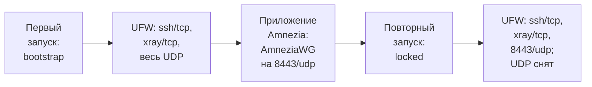

# Хост AmneziaVPN

[README](../README.md) · [Вся документация](README.md)

`optimize_amnezia_host.sh` готовит чистый Debian 12/13 VPS под AmneziaVPN self-hosted, которым управляет приложение Amnezia. Скрипт настраивает только хост: пользователя-оператора, SSH, firewall, Fail2Ban, сетевой стек на 10 Гбит/с, swap, Docker CE. Протоколы (AmneziaWG, XRay, OpenVPN, Cloak) он не ставит: приложение подключается к серверу по SSH и само разворачивает их контейнеры. Руководство для администратора, который запускает скрипт от root на целевой машине.

| Скрипт | Версия | Debian | Права | Лог |
|---|---|---|---|---|
| `optimize_amnezia_host.sh` | `0.3.0` (`SCRIPT_VERSION`) | 12 (bookworm), 13 (trixie) | root: `sudo` от обычного пользователя или root с `--user` | `/var/log/amnezia_host_optimization.log` |

> [!WARNING]
> Скрипт обновляет пакеты, создает пользователя и выдает ему sudo без пароля, закрывает вход по SSH для всех остальных учетных записей и для root, включает UFW, переписывает sysctl и лимиты, создает swap и ставит Docker. Запускай его только на целевой машине (VPS под Amnezia), не на рабочей станции. Перед запуском сделай снимок VPS: единого отката нет, см. [Повторный запуск и откат](#повторный-запуск-и-откат).

## Содержание

- [Для чего](#для-чего)
- [Требования](#требования)
- [Быстрый старт](#быстрый-старт)
- [Параметры запуска](#параметры-запуска)
- [Что делает скрипт](#что-делает-скрипт)
- [Файлы, которые пишет скрипт](#файлы-которые-пишет-скрипт)
- [Проверка после запуска](#проверка-после-запуска)
- [Повторный запуск и откат](#повторный-запуск-и-откат)
- [Решение проблем](#решение-проблем)
- [См. также](#см-также)

## Для чего

Скрипт нужен, когда на VPS должно быть ровно то, что требуется приложению Amnezia, и ничего лишнего:

- один пользователь-оператор с ключом SSH, в группах `sudo` и `docker`, с sudo без пароля;
- SSH только по ключу, только для этого пользователя, с кастомным портом по желанию (`--ssh-port`);
- Fail2Ban для SSH;
- сетевой стек под каналы до 10 Гбит/с: BBR, `fq`, буферы до 64 MB, расширенные очереди, conntrack до 262144, `rp_filter = 2`;
- модули ядра `tcp_bbr`, `tun`, `wireguard`, загружаемые при старте;
- swapfile 2G по умолчанию для VPS с небольшим объемом RAM;
- UFW в двух фазах (`bootstrap` → `locked`) и `DEFAULT_FORWARD_POLICY="ACCEPT"` для маршрутизации VPN;
- vanilla Docker CE из официального репозитория, без `daemon.json` и systemd override;
- Fish и Starship (`nerd-font-symbols`) для интерактивных сессий; в `/etc/passwd` остается `/bin/bash`, чтобы неинтерактивные команды приложения Amnezia работали;
- локали `en_US.UTF-8` и `ru_RU.UTF-8` для SSH-клиентов, с сохранением системного языка;
- опционально ядро из Debian Backports на Debian 12 (`--kernel-backports`).

Чего скрипт намеренно не делает (это есть в `optimize_vps.sh`): Go, Node.js/fnm и другой dev-стек; `daemon.json` и systemd override для Docker; эвристика swap; CPU governor и I/O scheduler; вспомогательные скрипты мониторинга и очистки. Если нужен полный VPS с окружением разработки, используй [`optimize_vps.sh`](README_VPS.md). Если цель — чистый хост под приложение Amnezia, этот скрипт.

## Требования

- Debian 12 или 13 (`ID=debian`, `VERSION_ID` 12 или 13 в `/etc/os-release`). Другие версии и дистрибутивы скрипт отклоняет до каких-либо изменений.
- Права root: обычный пользователь через `sudo` или root. `--help` работает без root.
- Целевой пользователь (оператор) определен: `--user` или `SUDO_USER`, см. [Параметры запуска](#параметры-запуска). root целевым пользователем быть не может.
- У целевого пользователя есть ключ SSH: непустой `~/.ssh/authorized_keys` со строкой `ssh-*`, `ecdsa-*` или `sk-*`, либо ключ передан через `--ssh-public-key` или `--ssh-public-key-file`. Без ключа скрипт останавливается до SSH-закалки: парольный вход будет закрыт.
- Доступ в интернет: `deb.debian.org`, `download.docker.com` (Docker CE), `github.com` (Starship, если его нет в Debian).
- systemd. Без systemd служба SSH не перезапускается, поэтому смена `--ssh-port` отклоняется до изменений; без смены порта drop-in записывается, а перезапуск SSH остается за тобой.
- Для `--kernel-backports` нужна перезагрузка после скрипта (только Debian 12; на Debian 13 шаг пропускается).

## Быстрый старт

В примерах имя оператора берется из переменной `OPERATOR`. Задай ее один раз в той же сессии оболочки (замени `ops` на свое имя):

```bash
OPERATOR=ops
```

Запуск под root (например, первый вход на VPS от root):

```bash
bash <(curl -fsSL https://raw.githubusercontent.com/snaplyze/optimize-debian/main/optimize_amnezia_host.sh) --user "$OPERATOR" --yes
```

Рекомендуемый режим под `sudo` от самого оператора (host baseline + Docker CE; целевой пользователь — `SUDO_USER`, `--user` не нужен):

```bash
sudo ./optimize_amnezia_host.sh --yes
```

Если пользователя еще нет и его нужно создать сразу (ключи берутся из `authorized_keys` пользователя, вызвавшего `sudo`, и добавляются без дублей):

```bash
sudo ./optimize_amnezia_host.sh --user "$OPERATOR" --create-user --yes
```

Если у вызвавшего `sudo` пользователя нет `authorized_keys` (или запуск идет от root), передай ключ явно:

```bash
sudo ./optimize_amnezia_host.sh --user "$OPERATOR" --create-user \
  --ssh-public-key 'ssh-ed25519 AAAA... your-key' --yes

sudo ./optimize_amnezia_host.sh --user "$OPERATOR" --create-user \
  --ssh-public-key-file "/root/$OPERATOR.pub" --yes
```

Если Docker должен ставить сам Amnezia app:

```bash
sudo ./optimize_amnezia_host.sh --skip-docker --yes
```

Если swap уже настроен вручную и менять его не нужно:

```bash
sudo ./optimize_amnezia_host.sh --skip-swap --yes
```

После того как приложение закрепило AmneziaWG на 8443/udp, второй запуск закрывает временное правило UDP:

```bash
sudo ./optimize_amnezia_host.sh --firewall-phase locked --yes
```

Закрепленный выпуск вместо `main` (теги `vГГГГ.ММ.ДД`, см. [Версии и выпуски](../README.md#версии-и-выпуски)):

```bash
TAG=v2026.10.21   # последний выпуск: https://github.com/snaplyze/optimize-debian/releases/latest
bash <(curl -fsSL "https://raw.githubusercontent.com/snaplyze/optimize-debian/$TAG/optimize_amnezia_host.sh") --user "$OPERATOR" --yes
```

Без `--yes` скрипт показывает выбранные параметры (пользователь, swap, Docker, Fish, ядро, порты, фаза firewall) и спрашивает `Proceed? [y/N]`.

## Параметры запуска

| Флаг | Значение | Умолчание | Что делает |
|---|---|---|---|
| `--user <name>` | имя пользователя | `SUDO_USER` | Целевой пользователь (оператор). `root` отклоняется: при `PermitRootLogin no` он остался бы без входа. |
| `--create-user` | — | выключено | Создать целевого пользователя, если его нет (`adduser --disabled-password`, домашний каталог, `authorized_keys`). Без флага отсутствующий пользователь — ошибка. |
| `--ssh-public-key <key>` | строка публичного ключа | пусто | Ключ для целевого пользователя; добавляется в `authorized_keys` без дублей. Имеет приоритет над `--ssh-public-key-file` и `SUDO_USER`. |
| `--ssh-public-key-file <p>` | путь к файлу | пусто | Файл с одним или несколькими ключами; все строки добавляются без дублей. Файл должен существовать, иначе ошибка при разборе аргументов. |
| `--ssh-port <port>` | 1–65535 | `22` | Порт SSH в drop-in sshd, в Fail2Ban и в UFW. Не может совпадать с `--xray-port` (оба TCP). |
| `--xray-port <port>` | 1–65535 | `443` | TCP-порт XRay, открывается в UFW. |
| `--amneziawg-port <port>` | 1–65535 | `8443` | UDP-порт AmneziaWG, открывается в UFW только в фазе `locked`. |
| `--swap-size-gb <size>` | целое число больше 0 | `2` | Размер `/swapfile` в GiB. |
| `--skip-swap` | — | выключено | Не создавать swapfile. |
| `--skip-docker` | — | выключено | Не ставить Docker CE (Docker поставит приложение Amnezia). |
| `--skip-fish` | — | выключено | Не ставить Fish и Starship. |
| `--kernel-backports` | — | выключено | На Debian 12 подключить `bookworm-backports` и поставить `linux-image-<arch>` и `linux-headers-<arch>` из него; если пакеты не из Backports, скрипт останавливается. На Debian 13 шаг пропускается. Нужна перезагрузка. |
| `--firewall-phase <phase>` | `bootstrap` или `locked` | `bootstrap` | Фаза UFW, см. [Firewall в две фазы](#firewall-в-две-фазы). |
| `--yes` | — | выключено | Без вопросов: не показывать сводку и не спрашивать подтверждения, в том числе при предупреждении о потере входа. |
| `--help` | — | — | Показать справку и выйти; работает без root. |

Неизвестный флаг — справка и код выхода 1. Все проверки аргументов (порты, размер swap, фаза, файл ключа, `root` как `--user`) выполняются до проверки root и до любых изменений.

Как выбирается целевой пользователь:

- `--user <имя>` — явно;
- без `--user` — пользователь, запустивший скрипт через `sudo` (`SUDO_USER`), если это не root;
- запуск от root без `sudo` (например, `bash <(curl ...)` от root) без `--user` останавливается с ошибкой `Target user is not set`: молчаливого значения по умолчанию нет.

Если скрипт запустил не целевой пользователь (`SUDO_USER`, а без `sudo` — пользователь по `logname`, в том числе root), скрипт предупреждает, что после перезапуска SSH эта учетная запись потеряет вход по SSH (`AllowUsers` пускает только целевого пользователя, `PermitRootLogin no`): в интерактивном режиме спрашивает `Continue anyway? [y/N]`, с `--yes` только выводит предупреждение. Перед запуском проверь, что у целевого пользователя есть рабочий ключ.

## Что делает скрипт

Шаги идут в порядке исполнения (`main`). До первого шага выполняются проверки: аргументы, root, целевой пользователь, `/etc/os-release` (Debian 12 или 13), существование пользователя (или `--create-user`), сводка и подтверждение (без `--yes`), предупреждение о потере входа.

1. **Обновление системы и базовые пакеты.** `apt-get update`, `apt-get upgrade -y`, затем `ca-certificates curl sudo gnupg lsb-release nftables iptables ufw fail2ban python3-systemd` (`python3-systemd` нужен бэкенду `systemd` в Fail2Ban). apt ждет освобождения блокировки dpkg до 300 с.
2. **Локали UTF-8.** Ставит `locales`, вписывает `en_US.UTF-8 UTF-8` и `ru_RU.UTF-8 UTF-8` в `/etc/locale.gen`, выполняет `locale-gen --keep-existing` (ранее собранные локали сохраняются) и проверяет результат через `locale -a`. Системный язык (`/etc/default/locale`) не меняется.
3. **Ядро из Debian Backports** (только с `--kernel-backports`, только Debian 12). Пишет `/etc/apt/sources.list.d/debian-backports.sources` (`bookworm-backports`), ставит `linux-image-<arch>` и `linux-headers-<arch>` и проверяет, что установленные версии из Backports; иначе ошибка и остановка. В конце предупреждает, что нужна перезагрузка.
4. **Целевой пользователь.** Существующий пользователь: создается `~/.ssh` (0700); ключ из `--ssh-public-key`, иначе строки из `--ssh-public-key-file` или из `authorized_keys` пользователя `SUDO_USER` добавляются в `authorized_keys` без дублей; если источника нет и `authorized_keys` пуст — ошибка до закалки SSH. Новый пользователь (`--create-user`): имя проверяется (строчные латинские буквы, цифры, `_`, `-`; не начинается с цифры или дефиса; не только цифры; не длиннее 32 символов); источник ключей выбирается до `adduser` — с `--yes` без источника ошибка, без `--yes` скрипт просит вставить ключ (`SSH Public Key:`); затем `adduser --gecos "" --disabled-password`, `~/.ssh` (0700) и `authorized_keys` (0600).
5. **Права пользователя.** `usermod -aG sudo` (sudo group нужна приложениям, которые проверяют именно членство в группе); `/etc/sudoers.d/<имя>` и `/etc/sudoers.d/root` с `ALL=(ALL) NOPASSWD:ALL` — через `common_safe_write_sudoers`: содержимое пишется во временный файл, проверяется `visudo -cf` и только потом переносится на место; при ошибке прежний файл не меняется, скрипт останавливается. Если группа `docker` уже есть — `usermod -aG docker`.
6. **Синхронизация времени** (preserve-first, общий шаг с VPS и мини-ПК). Если установлен `chrony`, `ntpsec`, `ntp`, `openntpd` или `systemd-timesyncd`, скрипт оставляет его и запускает, если не активен; другой daemon не ставится — в Debian эти пакеты конфликтуют. Если нет ни одного, ставит `systemd-timesyncd`. Затем `timedatectl set-ntp true` и сообщение, синхронизированы ли часы (`timedatectl show -p NTPSynchronized`). Ошибка шага не останавливает скрипт.
7. **Swap.** С `--skip-swap` пропускается. Если активный swap есть (`swapon --show`), ничего не меняется. Если `/swapfile` существует, но не активен, файл не перезаписывается (предупреждение). Иначе `fallocate -l <N>G` (или `dd`), `chmod 600`, `mkswap`, `swapon` и строка `/swapfile none swap sw 0 0` в `/etc/fstab`, если ее нет.
8. **Docker CE** (без `--skip-docker`). Ключ репозитория скачивается при каждом запуске и принимается только с закрепленным отпечатком `9DC858229FC7DD38854AE2D88D81803C0EBFCD88` → `/etc/apt/keyrings/docker.gpg`; при отказе шаг и скрипт останавливаются, репозиторий не добавляется. Источник deb822 `/etc/apt/sources.list.d/docker.sources` с `Architectures: $(dpkg --print-architecture)`. Пакеты: `docker-ce docker-ce-cli containerd.io docker-buildx-plugin docker-compose-plugin`. Включаются `docker.service` и `docker.socket`, создается группа `docker`, шаг 5 повторяется, чтобы добавить пользователя в `docker`. `daemon.json` и override не пишутся.
9. **Fish и Starship** (без `--skip-fish`). Ставит `fish`; Starship — пакет Debian, если он есть в выпуске (Debian 13), иначе закрепленный релиз `v1.27.0` с проверкой SHA-256 в `/usr/local/bin/starship`. Для целевого пользователя и для root: `~/.config/starship.toml` из `starship preset nerd-font-symbols`, `~/.config/fish/config.fish` (без `fish_greeting`, `starship init fish`), в `~/.bashrc` дописывается блок с `exec fish` только для интерактивных сессий без `SSH_ORIGINAL_COMMAND`. Логин-шелл в `/etc/passwd` остается `/bin/bash`: приложение Amnezia выполняет по SSH неинтерактивные команды Bash (`if ...; then ...; fi`, `export LC_ALL=C`), которые Fish не разбирает.
10. **Модули ядра и sysctl на 10 Гбит/с.** `/etc/modules-load.d/99-amnezia-host.conf` (`tcp_bbr`, `tun`, `wireguard`) и `modprobe` каждого; `/etc/sysctl.d/99-amnezia-host.conf`; `/etc/security/limits.d/99-amnezia-limits.conf`; `sysctl -e -p`. Максимальный буфер — 64 MB, на машинах с RAM меньше 3 GiB — 32 MB. Значения в [таблице файлов](#файлы-которые-пишет-скрипт).
11. **Fail2Ban.** `/etc/fail2ban/jail.local`: `[DEFAULT]` `bantime = 3600`, `findtime = 600`, `maxretry = 5`, `backend = systemd`; `[sshd]` `enabled = true`, `port = <ssh-port>`, `maxretry = 3`, `bantime = 7200`. Существующий файл с другим содержимым сначала копируется в `jail.local.backup.<дата_время>`; совпадающий не трогается. Служба включается и перезапускается.
12. **Закалка SSH.** Порядок не отрезает текущую сессию:
    - без systemd и со сменой порта — ошибка до изменений;
    - существующий `00-amnezia-host-hardening.conf` копируется во временный файл; `99-amnezia-host-hardening.conf` прежних версий (с заголовком `# Minimal Amnezia host SSH baseline`) тоже копируется и удаляется — файл с тем же именем, но другим содержимым остается;
    - пишется drop-in `/etc/ssh/sshd_config.d/00-amnezia-host-hardening.conf`;
    - `sshd -t`; при ошибке drop-in откатывается, скрипт останавливается;
    - сверка действующих значений через `sshd -T` (`common_sshd_effective_mismatches`): `permitrootlogin no`, `passwordauthentication no`, `pubkeyauthentication yes`, `permitemptypasswords no`, `kbdinteractiveauthentication no`, `allowusers <пользователь>`, `port <ssh-port>`; при расхождении скрипт называет параметры, откатывает drop-in без перезапуска SSH и останавливается (значения задает drop-in, который сортируется раньше, или строка выше `Include` в `/etc/ssh/sshd_config`, либо `sshd_config` вовсе не подключает каталог drop-in — нет строки `Include /etc/ssh/sshd_config.d/*.conf`, и файл не читается);
    - если UFW уже активен и правила для нового порта нет, порт открывается в UFW до перезапуска SSH; не удалось — откат drop-in и остановка;
    - без systemd: предупреждение «перезапусти SSH вручную», drop-in остается;
    - `systemctl restart ssh.service` (запасной вариант `sshd.service`). Если перезапуск не удался (например, порт занят), скрипт возвращает прежний drop-in, удаляет добавленное им правило UFW, перезапускает SSH еще раз и останавливается с ошибкой, в которой указан путь к drop-in.
13. **Firewall (UFW).** Без `ufw` шаг пропускается с предупреждением. В `/etc/default/ufw` `DEFAULT_FORWARD_POLICY="ACCEPT"` (остальные строки не трогаются). `ufw default deny incoming`, `ufw default allow outgoing`, `ufw allow <ssh-port>/tcp`, `ufw allow <xray-port>/tcp`, затем правило фазы (см. ниже) и `ufw --force enable`.
14. **Сводка.** Пользователь, swap, Docker, Fish, фаза firewall, порты; в фазе `bootstrap` — напоминание ограничить UDP после закрепления `8443/udp`; после установки Docker — напоминание перелогиниться.

### Firewall в две фазы

При первой установке через приложение AmneziaWG может подняться на случайном UDP-порту, поэтому ранний lock-down только на `8443/udp` сломал бы первичную установку.



| Фаза | Когда | Правила UFW |
|---|---|---|
| `bootstrap` (по умолчанию) | до того, как приложение закрепило UDP-порт AmneziaWG | `<ssh-port>/tcp`, `<xray-port>/tcp`, `allow from any to any proto udp comment 'Temporary AmneziaWG bootstrap allowance'` |
| `locked` | после закрепления AmneziaWG на `8443/udp` (или `--amneziawg-port`) | `<ssh-port>/tcp`, `<xray-port>/tcp`, `<amneziawg-port>/udp`; временное правило `Anywhere/udp` удаляется (`ufw --force delete allow from any to any proto udp`) |

> [!IMPORTANT]
> Docker публикует порты собственными правилами netfilter в обход UFW. После того как приложение подняло контейнеры, проверь `docker ps` и `ss -tulpn`: опубликованы только ожидаемые порты (`443/tcp`, `8443/udp`) и нет лишних. Скрипт делает host baseline и не заменяет эту проверку.

## Файлы, которые пишет скрипт

Пути и содержимое взяты из кода. «Как откатить» — ручные команды; скрипт сам откатывает только SSH drop-in (при ошибке `sshd -t`, сверки `sshd -T` или перезапуска).

| Путь | Что | Как откатить |
|---|---|---|
| `/etc/ssh/sshd_config.d/00-amnezia-host-hardening.conf` | закалка SSH (содержимое ниже); `99-amnezia-host-hardening.conf` прежних версий удаляется | `rm` файла, `sshd -t`, `systemctl restart ssh`; прежние значения возвращаются из `sshd_config` и других drop-in; старый `99-*.conf` не восстанавливается |
| `/etc/ssh/sshd_config.d/99-amnezia-host-hardening.conf` | удаляется, если начинается с `# Minimal Amnezia host SSH baseline` | не нужен: его заменяет `00-*.conf` |
| `/etc/sudoers.d/<пользователь>`, `/etc/sudoers.d/root` | `<имя> ALL=(ALL) NOPASSWD:ALL`, проверены `visudo -cf` | `rm` файлов; `gpasswd -d <пользователь> sudo`, `gpasswd -d <пользователь> docker` при необходимости |
| `/home/<пользователь>/.ssh/authorized_keys` | добавленные ключи (без дублей), права 0600 | удалить добавленные строки; созданного пользователя — `deluser --remove-home <имя>` (необратимо) |
| `/etc/default/ufw` | `DEFAULT_FORWARD_POLICY="ACCEPT"` | вернуть прежнее значение (в Debian по умолчанию `"DROP"`), `ufw reload` |
| правила UFW | deny incoming, allow outgoing, `<ssh-port>/tcp`, `<xray-port>/tcp`, правило фазы; UFW включен | `ufw status numbered`, `ufw delete <N>`; полностью — `ufw disable` и `ufw --force reset` |
| `/etc/fail2ban/jail.local` | jail `sshd` на `<ssh-port>`, бэкенд `systemd`; прежний файл — в `jail.local.backup.<дата_время>` | вернуть копию `.backup.*` или `rm`, `systemctl restart fail2ban` |
| `/etc/sysctl.d/99-amnezia-host.conf` | sysctl на 10 Гбит/с (ниже) | `rm`, затем `sysctl --system`; значения в ядре остаются до перезагрузки или ручного `sysctl -w` |
| `/etc/modules-load.d/99-amnezia-host.conf` | `tcp_bbr`, `tun`, `wireguard` | `rm`; модули выгрузятся после перезагрузки |
| `/etc/security/limits.d/99-amnezia-limits.conf` | `nofile 524288` (soft и hard, `*` и `root`), `memlock unlimited` | `rm`; действует для новых сессий |
| `/swapfile`, строка в `/etc/fstab` | swapfile `<N>G` (по умолчанию 2G), `/swapfile none swap sw 0 0` | `swapoff /swapfile`, удалить строку из `/etc/fstab`, `rm /swapfile` |
| `/etc/apt/keyrings/docker.gpg`, `/etc/apt/sources.list.d/docker.sources` | ключ Docker с закрепленным отпечатком, источник deb822 | `rm` обоих, `apt-get update`; пакеты — `apt-get purge docker-ce docker-ce-cli containerd.io docker-buildx-plugin docker-compose-plugin` |
| `/etc/apt/sources.list.d/debian-backports.sources` | `bookworm-backports` (только `--kernel-backports` на Debian 12) | `rm`, `apt-get update`; установленное ядро остается, пока его не удалить |
| `/etc/locale.gen` | строки `en_US.UTF-8 UTF-8`, `ru_RU.UTF-8 UTF-8` | откат не нужен; лишние локали можно удалить из файла и выполнить `locale-gen` |
| `~/.config/starship.toml`, `~/.config/fish/config.fish`, блок `exec fish` в `~/.bashrc` (пользователь и root) | Fish и Starship для интерактивных сессий | удалить файлы и блок из `~/.bashrc`; `apt-get purge fish`; `rm /usr/local/bin/starship`, если Starship ставился из релиза |
| `/var/log/amnezia_host_optimization.log` | сообщения скрипта и вывод apt | `rm` |

Содержимое `/etc/ssh/sshd_config.d/00-amnezia-host-hardening.conf`:

```text
# Minimal Amnezia host SSH baseline
PermitRootLogin no
PasswordAuthentication no
PubkeyAuthentication yes
PermitEmptyPasswords no
KbdInteractiveAuthentication no
ChallengeResponseAuthentication no
X11Forwarding no
ClientAliveInterval 300
ClientAliveCountMax 2
MaxAuthTries 3
AllowUsers <пользователь>
Port <ssh-port>
```

sshd берет первое прочитанное значение параметра, а drop-in из `/etc/ssh/sshd_config.d/` читает по порядку имен, поэтому файл назван `00-…` и действует раньше других drop-in (например, `50-cloud-init.conf` с `PasswordAuthentication yes`). Других параметров sshd скрипт не задает. `X11Forwarding`, `ClientAlive*` и `MaxAuthTries` можно переопределить в drop-in, имя которого сортируется раньше (например, `00-00-local.conf`), а параметры входа (`PermitRootLogin`, `PasswordAuthentication`, `PubkeyAuthentication`, `PermitEmptyPasswords`, `KbdInteractiveAuthentication`, `AllowUsers`, `Port`) — нельзя: скрипт остановится на сверке `sshd -T`.

<details>
<summary>Содержимое <code>/etc/sysctl.d/99-amnezia-host.conf</code> (сетевой стек до 10 Гбит/с)</summary>

Буфер `<max>` — `67108864` (64 MB), а на машинах с RAM меньше 3 GiB — `33554432` (32 MB).

```text
net.core.default_qdisc = fq
net.ipv4.tcp_congestion_control = bbr

net.ipv4.ip_forward = 1
net.ipv6.conf.all.forwarding = 1

net.core.rmem_default = 1048576
net.core.wmem_default = 1048576
net.core.rmem_max = <max>
net.core.wmem_max = <max>
net.core.optmem_max = 2097152
net.ipv4.tcp_rmem = 4096 1048576 <max>
net.ipv4.tcp_wmem = 4096 1048576 <max>

net.ipv4.udp_rmem_min = 16384
net.ipv4.udp_wmem_min = 16384

net.core.netdev_max_backlog = 32768
net.core.somaxconn = 32768
net.ipv4.tcp_max_syn_backlog = 16384

net.ipv4.tcp_fastopen = 3
net.ipv4.tcp_slow_start_after_idle = 0
net.ipv4.tcp_tw_reuse = 1
net.ipv4.tcp_fin_timeout = 15
net.ipv4.tcp_mtu_probing = 1
net.ipv4.tcp_window_scaling = 1
net.ipv4.tcp_timestamps = 1
net.ipv4.tcp_sack = 1

net.netfilter.nf_conntrack_max = 262144

net.ipv4.conf.all.rp_filter = 2
net.ipv4.conf.default.rp_filter = 2
net.ipv4.conf.all.accept_source_route = 0
net.ipv4.conf.default.accept_source_route = 0
net.ipv6.conf.all.accept_source_route = 0
net.ipv6.conf.default.accept_source_route = 0
net.ipv4.conf.all.accept_redirects = 0
net.ipv4.conf.default.accept_redirects = 0
net.ipv6.conf.all.accept_redirects = 0
net.ipv6.conf.default.accept_redirects = 0
net.ipv4.conf.all.send_redirects = 0
net.ipv4.conf.default.send_redirects = 0
vm.swappiness = 10
```

`rp_filter = 2` (loose) нужен для асимметричной маршрутизации WireGuard/AmneziaWG, OpenVPN и мостов Docker.

</details>

## Проверка после запуска

Открой новую SSH-сессию от имени оператора, не закрывая текущую, и проверь:

```bash
sudo sshd -t
sudo sshd -T | grep -Ei '^(permitrootlogin|passwordauthentication|allowusers|port) '
sudo systemctl status ssh fail2ban docker --no-pager
sudo fail2ban-client status sshd
sudo ufw status verbose
sysctl net.ipv4.ip_forward net.ipv4.tcp_congestion_control net.core.default_qdisc
lsmod | grep -E '^(tcp_bbr|tun|wireguard) '
swapon --show
id "$OPERATOR"
sudo -n true && echo 'sudo без пароля работает'
locale -a | grep -Ei '^(en_US|ru_RU)\.utf-?8$'
```

Ожидается: `AllowUsers <оператор>`, `PermitRootLogin no`, `PasswordAuthentication no`, порт из `--ssh-port`; в `ufw status` — `<ssh-port>/tcp`, `<xray-port>/tcp` и либо `Anywhere/udp` (`bootstrap`), либо `<amneziawg-port>/udp` (`locked`); `tcp_congestion_control = bbr`, `default_qdisc = fq`; `id` показывает группы `sudo` и `docker`.

Если Docker ставился скриптом, перелогинься перед использованием Docker без sudo. После `--kernel-backports` перезагрузись и сверь `uname -r`.

Затем в приложении Amnezia подключись к серверу как оператор по ключу и дай ему развернуть протоколы. После деплоя проверь опубликованные Docker порты (`docker ps`, `ss -tulpn`) и выполни второй запуск с `--firewall-phase locked`.

## Повторный запуск и откат

Повторный запуск с теми же флагами безопасен и задуман: второй запуск с `--firewall-phase locked` — штатный способ закрыть временное правило UDP. При повторе:

- `apt-get upgrade` выполняется снова;
- `authorized_keys` и `~/.bashrc` не дублируются (ключи сравниваются построчно, блок `exec fish` ищется по строке);
- swap, который уже активен, не трогается;
- `jail.local` переписывается только при отличии, прежний уходит в `.backup.<дата_время>`;
- SSH drop-in переписывается; при любой ошибке возвращается прежний;
- правила UFW, которые уже есть, не добавляются второй раз; UFW остается включенным;
- sudoers и sysctl переписываются теми же значениями; ключ Docker скачивается заново.

Смена порта SSH повторным запуском: `--ssh-port <новый>` открывает новый порт в активном UFW до перезапуска SSH; старый порт из UFW скрипт не удаляет — закрой его сам (`ufw delete allow 22/tcp`) после проверки входа по новому.

Единого отката нет: скрипт не хранит снимок прежнего состояния (кроме `jail.local.backup.*`). Надежный откат — снимок VPS, сделанный до запуска. Ручной откат по файлам — в таблице [Файлы, которые пишет скрипт](#файлы-которые-пишет-скрипт); порядок, который не отрезает сессию: сначала SSH drop-in (`rm`, `sshd -t`, `systemctl restart ssh`, проверка входа из новой сессии), затем UFW, остальное в любом порядке. Удаленные пакеты (`docker-ce`, `fish`, ядро из Backports) и созданный пользователь откатываются только вручную.

## Решение проблем

**`Target user is not set`.** Запуск от root без `sudo` и без `--user`. Добавь `--user "$OPERATOR"`.

**`root cannot be the target user`.** `--user root` недопустим: `PermitRootLogin no` оставил бы сервер без входа. Укажи обычного пользователя, при необходимости с `--create-user`.

**`User <имя> does not exist`.** Пользователя нет, а `--create-user` не передан.

**`Existing user <имя> has no authorized_keys`** или **`Cannot create <имя> safely`.** Нет источника ключей: передай `--ssh-public-key` или `--ssh-public-key-file`, либо заранее положи ключ в `~/.ssh/authorized_keys` пользователя. С `--yes` интерактивного запроса ключа нет.

**Предупреждение `You are logged in as <X>, but SSH hardening allows only <Y>`.** После перезапуска SSH текущая учетная запись потеряет вход. Прервись (`N`) и запусти от нужного пользователя, или убедись, что у `<Y>` есть рабочий ключ, и проверь вход из новой сессии до закрытия текущей.

**`SSH port and XRay port must differ`.** Оба порта TCP; выбери разные `--ssh-port` и `--xray-port`.

**`sshd does not take the hardening values (sshd -T)`.** Другой drop-in с именем, которое сортируется раньше `00-amnezia-host-hardening.conf`, или строка выше `Include` в `/etc/ssh/sshd_config` задает перечисленные параметры; либо в `/etc/ssh/sshd_config` нет строки `Include /etc/ssh/sshd_config.d/*.conf`, и drop-in не читается вовсе. Скрипт уже вернул прежнюю конфигурацию и не перезапускал SSH. Убери конфликт и запусти снова.

**`Failed to restart the SSH service`.** Обычно новый порт занят. Скрипт вернул прежний drop-in, удалил добавленное правило UFW и перезапустил SSH на прежней конфигурации. Выбери другой `--ssh-port`; если SSH так и не поднялся — `systemctl status ssh` и `journalctl -u ssh` с консоли провайдера.

**`systemd is not available, so the SSH service cannot be restarted`.** Без systemd смена порта отклоняется. Оставь текущий порт или перезапусти SSH сам.

**Нет входа по SSH после запуска.** Через консоль провайдера проверь `sshd -T | grep -E '^(allowusers|port) '` и `ufw status`: вход разрешен только оператору по ключу, на порту из `--ssh-port`. Временно вернуть прежнее поведение: `rm /etc/ssh/sshd_config.d/00-amnezia-host-hardening.conf && sshd -t && systemctl restart ssh`.

**Контейнер приложения доступен, хотя в UFW порт закрыт.** Docker публикует порты в обход UFW; сверь `docker ps` и `ss -tulpn`, лишние публикации убирай в настройках контейнера.

**`Debian Backports kernel ... was not installed`.** Пакеты `linux-image-<arch>`/`linux-headers-<arch>` не установились из `bookworm-backports` (нет сети к `deb.debian.org`, другая архитектура). Скрипт останавливается; источник Backports уже записан.

**`Bootstrap firewall phase enabled: temporary all-UDP ingress remains open`.** Это не ошибка: напоминание выполнить второй запуск с `--firewall-phase locked` после закрепления AmneziaWG на `8443/udp`.

### Ошибка setlocale при входе по SSH

Предупреждение `cannot change locale (ru_RU.UTF-8)` означает, что сессия запрашивает локаль, которой нет на сервере. Например, SSH-клиент передает `LC_ALL`, `LC_CTYPE` или `LC_MESSAGES`, а минимальный образ Debian содержит только `C` и `C.UTF-8`. Старые версии этого скрипта не генерировали дополнительные локали; `export LC_ALL=C` внутри скрипта защищает только его собственные команды.

Текущий скрипт генерирует обе локали и проверяет их через `locale -a`. Чтобы исправить уже настроенный сервер без повторного запуска всего профиля, выполни в Bash (если открыт Fish, сначала запусти `bash`):

```bash
sudo env LC_ALL=C LANG=C apt-get update
sudo env LC_ALL=C LANG=C apt-get install -y locales
sudo env LC_ALL=C LANG=C bash <<'EOF'
set -euo pipefail
touch /etc/locale.gen
for name in en_US ru_RU; do
    sed -i -E "/^[[:space:]#]*${name}\\.UTF-8[[:space:]]+UTF-8([[:space:]]|$)/d" /etc/locale.gen
    printf '%s.UTF-8 UTF-8\n' "$name" >> /etc/locale.gen
done
locale-gen --keep-existing
locale -a | grep -Ei '^(en_US|ru_RU)\.(utf8|utf-8)$'
EOF
```

В результате должны появиться `en_US.utf8` и `ru_RU.utf8`. Затем открой новую SSH-сессию и проверь `locale`: предупреждений быть не должно. Перезагрузка сервера и перезапуск SSH не требуются. Для другой клиентской локали добавь соответствующую строку в `/etc/locale.gen`.

Генерация исправляет причину ошибки; файл `/var/lib/cloud/instance/locale-check.skip` лишь скрывает предупреждение cloud-init. Описание штатного механизма: [Debian locale-gen(8)](https://manpages.debian.org/trixie/locales/locale-gen.8.en.html).

<details>
<summary>Проверка исправления (9 сентября 2026)</summary>

В одноразовых контейнерах Debian 12.15 и 13.6 воспроизведено предупреждение до генерации; после настройки проверены все варианты выбора языка в VPS, Mini PC и WSL2, сохранение дополнительных локалей и запуск отдельных скриптов без `lib/`. В Debian 13.6 также проверены команда и интерактивный вход через настоящий SSH с передачей `LC_ALL`, `LC_CTYPE` и `LC_MESSAGES=ru_RU.UTF-8`: предупреждений нет. Полное развертывание профилей и запуск внутри WSL2 в эту проверку не входили.

</details>

## См. также

- [README](../README.md) — выбор скрипта, быстрый старт, [Версии и выпуски](../README.md#версии-и-выпуски).
- [Вся документация](README.md) — оглавление `docs/`.
- [`optimize_vps.sh`](README_VPS.md) — полный VPS с dev-стеком, если чистого хоста мало.
- [Обновление до Debian 13](README_UPGRADE.md) — если на сервере Debian 11 или 12 и нужен Debian 13 до настройки.
- [Устройство репозитория](ARCHITECTURE.md) — встроенные копии `lib/`, тесты, CI, выпуски.
- [CHANGELOG](../CHANGELOG.md), [SECURITY](../SECURITY.md), [CONTRIBUTING](../CONTRIBUTING.md), [LICENSE](../LICENSE).
- Пресет Starship [`nerd-font-symbols`](https://starship.rs/ru-RU/presets/nerd-font).
