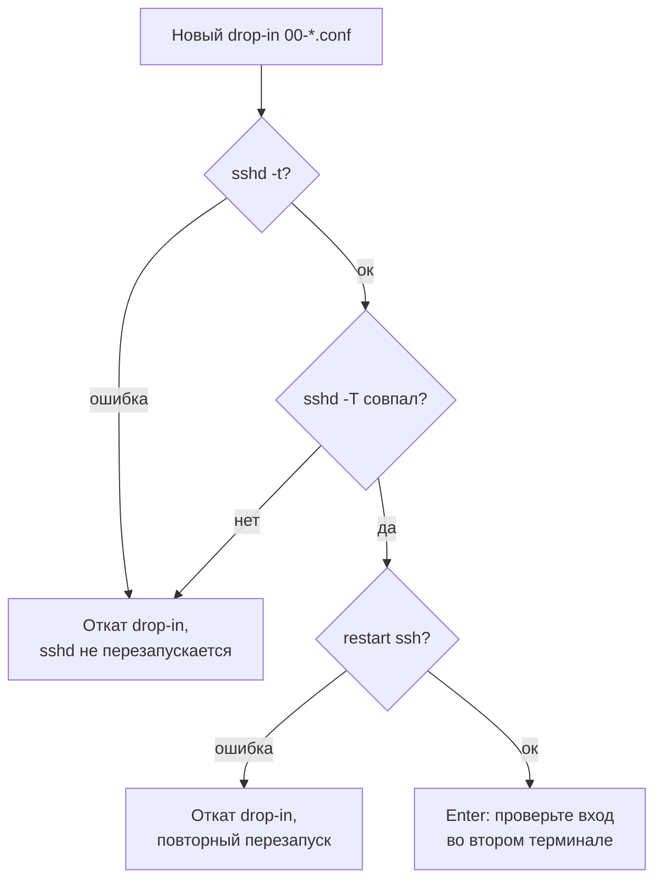

# Мини-ПК на Intel N5095

[README](../README.md) · [Вся документация](README.md)

`optimize_mini_pc.sh` превращает чистый Debian 12 или 13 на мини-ПК с Intel Celeron N5095 (Jasper Lake) в домашний или медиасервер: ядро Debian Backports на Debian 12, драйверы Intel QuickSync, планировщики ввода-вывода для NVMe и SATA SSD, Docker, Samba для локальной сети, Fish + Starship, Go и Node.js. Руководство для администратора, который запускает скрипт от root на целевой машине.

| Скрипт | Версия | Debian | Права | Лог |
|---|---|---|---|---|
| `optimize_mini_pc.sh` | 2.0.0 (`SCRIPT_VERSION`, печатает `--help`); закрепленный выпуск всего репозитория — тег вида `v2026.10.21` ([Версии и выпуски](../README.md#версии-и-выпуски)) | 12 (bookworm), 13 (trixie); на другой версии завершается с кодом 1 | root (`EUID` 0); иначе код 1 | `/var/log/minipc_optimization.log` — строки состояния скрипта и вывод `apt`; еженедельная очистка пишет в `/var/log/minipc-cleanup.log` |

> [!WARNING]
> Скрипт меняет систему: пакеты и ядро, пользователей и `/etc/sudoers.d/`, SSH (`/etc/ssh/sshd_config.d/`), UFW и Fail2Ban, sysctl, swap и `/etc/fstab`, udev, Samba, Docker. Запускайте его только от root на целевом мини-ПК с Debian 12 или 13, не на рабочей станции. Без root ничего не меняет только `--help`.

## Содержание

- [Для чего](#для-чего)
- [Требования](#требования)
- [Быстрый старт](#быстрый-старт)
- [Параметры запуска](#параметры-запуска)
- [Что делает скрипт](#что-делает-скрипт)
- [Файлы, которые пишет скрипт](#файлы-которые-пишет-скрипт)
- [Проверка после запуска](#проверка-после-запуска)
- [Повторный запуск и откат](#повторный-запуск-и-откат)
- [Решение проблем](#решение-проблем)
- [См. также](#см-также)

## Для чего

- Домашний сервер или медиасервер (Plex, Jellyfin) на мини-ПК без монитора: сетевые буферы 32 МБ, TCP Fast Open, BBR, расширенные очереди NVMe и SSD.
- Аппаратное транскодирование через Intel QuickSync: `intel-media-va-driver-non-free`, `vainfo`, `intel_gpu_top`, пользователь в группах `render` и `video`.
- Один sudo-пользователь с входом по SSH-ключу, UFW с открытыми 22, 80 и 443, Fail2Ban с `backend = systemd`.
- Общая папка Samba на диске `/mnt/ssd` только для локальной подсети, только NTLMv2 и SMB2+.
- Docker CE из репозитория Docker, Fish + Starship (пресет `nerd-font-symbols`), Go и Node.js LTS через fnm.

Особенности оборудования, которые учитывает скрипт:

| Узел | Что известно | Что делает скрипт |
|---|---|---|
| CPU Intel Celeron N5095 | Tremont (10 нм), SSE4.2 и AES-NI, без AVX/AVX2; пассивное или слабое охлаждение | Ядро `linux-image-<arch>` из `bookworm-backports` на Debian 12; governor `schedutil` (если нет — `powersave`, `ondemand`, `performance`) через `cpupower`; blacklist драйверов, вызывающих шторм прерываний на одном ядре |
| GPU Intel UHD Graphics | QuickSync Video через VA-API, устройство `/dev/dri` | Пакеты `intel-media-va-driver-non-free`, `intel-gpu-tools`, `vainfo`, `mesa-utils` и `libmfx-gen1.2` (или `libmfx1`); группы `render` и `video` |
| Диски NVMe и SATA SSD | NVMe работает с собственными очередями, SSD без вращения | udev: `none` для NVMe, `mq-deadline` для SSD, `bfq` для HDD; `fstrim.timer`; `/tmp` и `/var/tmp` в tmpfs с `noatime` |

## Требования

- Debian 12 (bookworm) или Debian 13 (trixie), `ID=debian` в `/etc/os-release`. Debian 11 сначала обновите через [`upgrade-to-debian13.sh`](README_UPGRADE.md). Рекомендуется образ netinst без графического окружения.
- Запуск от root в интерактивном терминале: скрипт спрашивает состав шагов, имя пользователя, пароль, SSH-ключ, локаль, часовой пояс и подсеть для Samba. Без терминала `gum` не ставится, вопросы задаются обычным `read`, а подсеть для Samba не запрашивается.
- Доступ в интернет к `deb.debian.org`, `download.docker.com`, `github.com` (gum, Starship на Debian 12, fnm), `dl.google.com` (Go) и `nodejs.org` (Node.js через fnm).
- Архитектура amd64 или arm64: закрепленные загрузки Starship, fnm и Go есть только для них (`dpkg --print-architecture`); для `gum` — x86_64, arm64 и armv7. Ядро из Backports ставится как `linux-image-<arch>`.
- Для Samba: диск уже смонтирован в `/mnt/ssd`; иначе шаг Samba пропускается с предупреждением.
- Для SSH-закалки: публичный ключ в формате одной строки `authorized_keys` (`ssh-ed25519`, `ssh-rsa`, `ecdsa-sha2-nistp256|384|521`, `sk-ssh-ed25519@openssh.com`, `sk-ecdsa-sha2-nistp256@openssh.com`), сгенерированный, например, `ssh-keygen -t ed25519` на рабочей машине.

## Быстрый старт

```bash
# Быстрый запуск (bash + curl)
bash <(curl -fsSL https://raw.githubusercontent.com/snaplyze/optimize-debian/main/optimize_mini_pc.sh)

# Или скачать скрипт
wget https://raw.githubusercontent.com/snaplyze/optimize-debian/main/optimize_mini_pc.sh

# Сделать исполняемым
chmod +x optimize_mini_pc.sh

# Запустить (требуется root/sudo)
sudo ./optimize_mini_pc.sh
```

Команды выше запускают текущий код из `main`. Закрепленный выпуск ведет себя одинаково при каждом запуске (см. [Версии и выпуски](../README.md#версии-и-выпуски)):

```bash
TAG=v2026.10.21   # последний выпуск: https://github.com/snaplyze/optimize-debian/releases/latest
bash <(curl -fsSL "https://raw.githubusercontent.com/snaplyze/optimize-debian/$TAG/optimize_mini_pc.sh")
```

Все шаги выполняются из функции `optimize_main`, которую вызывает последняя строка файла: оборванная загрузка останавливается на синтаксической ошибке и ничего не меняет. После завершения скрипт предлагает перезагрузку: ядро, группы и sysctl применяются полностью после нее.

## Параметры запуска

Аргументы командной строки:

| Аргумент | Действие |
|---|---|
| `-h`, `--help` | Печатает справку и завершается с кодом 0; root не нужен, система не меняется |
| без аргументов | Интерактивная настройка |
| любой другой | `Unknown argument: ...`, справка в stderr, код 2 |

Интерактивное меню (вопросы `[Y/n]` или `[y/N]`; через `gum`, если он есть или установился, иначе обычный `read`; `dialog` и `whiptail` автоматически не выбираются):

| Группа | Вопрос | По умолчанию | Флаги |
|---|---|---|---|
| System | Update system & Install base utils | да | `UPDATE_SYSTEM`, `INSTALL_BASE_UTILS` |
| System | Configure Locales (en_US + ru_RU) & Timezone | да | `CONFIGURE_LOCALES` |
| System | Create new sudo user & Harden SSH | да | `CREATE_USER`, `CONFIGURE_SECURITY` |
| Hardware | Install latest Linux kernel via Backports | да | `INSTALL_KERNEL` |
| Hardware | Install Intel GPU Drivers (QuickSync/Transcoding) | да | `INSTALL_INTEL_GPU` |
| Hardware | Optimize SSDs (TRIM, I/O scheduler) | да | `OPTIMIZE_SSD` |
| Hardware | Apply Performance Tuning (Sysctl, Limits, Swap, Tmpfs) | да | `PERFORMANCE_TUNING`, `DISABLE_SERVICES` |
| Software | Install Docker CE & Docker Compose | да | `INSTALL_DOCKER` |
| Software | Install Fish + Starship Shell | да | `INSTALL_FISH` |
| Software | Install Go (Latest) | да | `INSTALL_GO` |
| Software | Install Node.js (LTS via fnm) | да | `INSTALL_NODE` |
| File Sharing | Install Samba File Sharing | нет | `INSTALL_SAMBA`; затем имя общей папки, по умолчанию `SSD_Storage`, только `A-Z a-z 0-9 _ -` |

Вопросы внутри шагов: локаль по умолчанию (`1` en_US.UTF-8, `2` ru_RU.UTF-8, `3` обе с английской по умолчанию; неверный ввод — en_US.UTF-8), часовой пояс (Enter — оставить текущий), имя пользователя, пароль, SSH-ключ (Enter — пропустить), подсеть для Samba, если она не определилась, пароль Samba, перезагрузка в конце (по умолчанию да).

> [!IMPORTANT]
> Флаг `CONFIGURE_SECURITY` включается вместе с созданием пользователя и сбрасывается, если SSH-ключ не введен. Без ключа пропускаются и закалка SSH, и шаг «Security»: UFW, Fail2Ban и автообновления не настраиваются.

Переменные окружения, которые читает код (все необязательны):

| Переменная | Умолчание | Действие |
|---|---|---|
| `TUI_BACKEND` | `auto` | `gum`, `plain`, `dialog`, `whiptail`; `auto` — `gum`, если он есть или установился, иначе `plain` |
| `TUI_AUTO_INSTALL_GUM` | `true` | `false` — не скачивать `gum` |
| `GUM`, `TUI_GUM_BIN` | `/usr/local/bin/gum`, пусто | Путь к `gum`; `GUM` — и куда его установить |
| `TUI_GUM_VERSION` | `0.17.0` | Версия `gum`; SHA-256 закреплена только для 0.17.0, другая версия не ставится |
| `COMMON_DOWNLOAD_CONNECT_TIMEOUT`, `COMMON_DOWNLOAD_MAX_TIME`, `COMMON_DOWNLOAD_RETRIES` | `20`, `900`, `3` | Таймауты и повторы `curl` для загрузок Starship, fnm, Go и ключа Docker |
| `COMMON_STARSHIP_BIN` | `/usr/local/bin/starship` | Куда ставится закрепленный бинарник Starship |
| `OPTIMIZE_SOURCE_ONLY` | `0` | `1` — только определить функции без запуска шагов (для тестов) |

Таймауты APT (`COMMON_APT_LOCK_TIMEOUT=300`, `COMMON_APT_UPDATE_RETRY_DELAY=10`, `COMMON_APT_UPDATE_ATTEMPTS=30`) заданы в скрипте и из окружения не меняются.

## Что делает скрипт

Шаги идут в порядке `optimize_main`. Скрипт работает с `set -e`: ошибка команды без обработки останавливает его, и повторный запуск продолжает с начала.

0. **Pre-flight.** Читает `/etc/os-release`, требует Debian 12 или 13. `tui_init`: если stdout — терминал и есть `curl`, `tar`, `sha256sum`, скачивает `gum` 0.17.0 с проверкой SHA-256 в `/usr/local/bin/gum`. Показывает меню и выбранный профиль.
1. **System Update** (`UPDATE_SYSTEM`). Добавляет `contrib non-free non-free-firmware` ко всем источникам с `main` в `/etc/apt/sources.list` и `sources.list.d/*.list|*.sources` (нужно для `intel-media-va-driver-non-free`); `apt-get update` и `upgrade`. Базовые пакеты: `wget curl git htop iotop sysstat net-tools iptables ufw fail2ban python3-systemd unattended-upgrades apt-listchanges zip unzip gnupg ca-certificates lsb-release lm-sensors linux-cpupower speedtest-cli irqbalance fzf ripgrep fd-find bat bc needrestart ncdu tree vim nano tmux make gcc g++ cmake xz-utils xdg-user-dirs`; недоступные пакеты только предупреждение. Ссылки `/usr/bin/bat` → `batcat` и `/usr/bin/fd` → `fdfind`. `iptables`, `ip6tables` и их `-save` переключаются на `legacy` через `update-alternatives` (совместимость UFW и Docker).
2. **Locales & Timezone** (`CONFIGURE_LOCALES`). Ставит `locales`, генерирует `en_US.UTF-8` и `ru_RU.UTF-8` (`locale-gen --keep-existing`, остальные локали образа сохраняются), задает выбранную через `update-locale --reset LANG=... LANGUAGE=...` и пишет `/etc/profile.d/locale.sh`; `LC_ALL` не задается. Часовой пояс — `timedatectl set-timezone`, при ошибке символическая ссылка `/etc/localtime` и `/etc/timezone`. Синхронизация времени: оставляет первый установленный из `chrony`, `ntpsec`, `ntp`, `openntpd`, `systemd-timesyncd` и запускает его; ставит `systemd-timesyncd`, только если нет ни одного; затем `timedatectl set-ntp true`.
3. **User Creation** (`CREATE_USER`). Имя проверяется с повтором: не пустое, не только цифры, не начинается с цифры или дефиса, только `a-z 0-9 _ -` с первой буквой или `_`, до 32 символов. Существующий пользователь добавляется в `sudo`, смена пароля по желанию; новый создается `adduser --disabled-password`, добавляется в `sudo`, пароль задается `passwd` с повтором. `/etc/sudoers.d/<user>` и `/etc/sudoers.d/root` с `ALL=(ALL) NOPASSWD:ALL` пишутся через `common_safe_write_sudoers`: временный файл в `/etc/sudoers.d/` с именем через точку (sudo такие не читает), `visudo -cf`, затем `mv`; при ошибке прежний файл не меняется. Без этого шага пользователем для остальных шагов становится `logname`, затем `SUDO_USER`, иначе `root`.
   Затем SSH: ключ проверяется по типу и `ssh-keygen -l -f`, добавляется в `~/.ssh/authorized_keys` без дублей (`700` на `.ssh`, `600` на файл). С `CONFIGURE_SECURITY` применяется закалка (см. ниже); после успешного перезапуска sshd скрипт ждет Enter — проверьте вход новым ключом во втором терминале: `ssh <user>@<ip>`.
4. **Kernel & Hardware** (`INSTALL_KERNEL`). Удаляет `xanmod-release.list` и ключ XanMod прежних версий. Debian 12: пишет `/etc/apt/sources.list.d/debian-backports.sources` (`bookworm-backports`, компоненты `main contrib non-free non-free-firmware`, ключ `debian-archive-keyring.gpg`) и ставит `linux-image-<arch>` и `linux-headers-<arch>` с `-t bookworm-backports`; успех засчитывается, только если установленная версия действительно из Backports, иначе предупреждение и текущее ядро остается. Debian 13: те же пакеты из основного репозитория. Ставит `linux-cpupower`, выбирает governor `schedutil` → `powersave` → `ondemand` → `performance` по списку `cpupower frequency-info -g`, применяет сразу и через `cpupower-config.service`.
   **Intel GPU** (`INSTALL_INTEL_GPU`): пакеты из таблицы выше, группы `render` и `video` (`groupadd -f`), `usermod -aG video,render <user>` для не-root.
5. **Storage Optimization** (`OPTIMIZE_SSD`). `fstrim.timer` включается и запускается; пишется `/etc/udev/rules.d/60-ioschedulers.conf`, затем `udevadm control --reload` и `udevadm trigger`.
6. **Fish & Starship** (`INSTALL_FISH`). Ставит `fish curl git`; Starship — пакет Debian, если он есть (Debian 13), иначе закрепленный релиз 1.27.0 с проверкой SHA-256 в `/usr/local/bin/starship`. Для root и пользователя: `~/.config/starship.toml` (`starship preset nerd-font-symbols`) и `~/.config/fish/config.fish` профиля `mini`: без приветствия, пути Go, хук `fnm env --use-on-cd --shell fish`, алиасы, в том числе `gpuinfo` (`vainfo 2>/dev/null || intel_gpu_top`) и `temp` (`sensors`). Если `fish` после установки не найден — код 1.
7. **Bash Modernization** (всегда). Ставит `bash-completion`, пишет `~/.bashrc` профиля `mini` для root и пользователя: интерактивная сессия без `SSH_ORIGINAL_COMMAND` делает `exec fish`, остальное (cron, `scp`, `rsync`, `ssh host cmd`) остается в Bash; история 50 000 строк, `starship init bash`, пути Go и fnm. Чужой `.bashrc` (без заголовка профиля) сначала копируется в `.bashrc.backup.<ГГГГММДД_ЧЧММСС>.<суффикс>`; `/etc/passwd` не меняется, оболочкой входа остается `/bin/bash`.
8. **Go** (`INSTALL_GO`). Закрепленный релиз Go 1.27.3 с проверкой SHA-256 распаковывается рядом с `/usr/local/go` и подменяет его переименованием; при неудаче прежний каталог возвращается. `/etc/profile.d/golang.sh`; строки `GOROOT` добавляются в `.bashrc`, если их нет. Ошибка — код 1.
   **Node.js** (`INSTALL_NODE`). Нужны `curl` и `unzip` (ставятся при отсутствии). Закрепленный fnm 1.39.0 с проверкой SHA-256 ставится в `~/.local/share/fnm/fnm` для root и пользователя (`su - <user>`), затем `fnm install --lts --use`, `fnm default`, `corepack enable`. Сам Node.js LTS не закреплен: fnm скачивает текущий с nodejs.org. Рассчитано на чистую ОС, старые NVM-настройки не мигрируются. Ошибка — предупреждение, скрипт продолжается.
9. **Docker** (`INSTALL_DOCKER`). Удаляет `docker.io docker-doc docker-compose podman-docker containerd runc`; ключ репозитория в `/etc/apt/keyrings/docker.gpg` принимается только с отпечатком `9DC858229FC7DD38854AE2D88D81803C0EBFCD88` (иначе код 1); `/etc/apt/sources.list.d/docker.sources` (deb822, `Suites: <кодовое имя>`, `Architectures: $(dpkg --print-architecture)`); пакеты `docker-ce docker-ce-cli containerd.io docker-buildx-plugin docker-compose-plugin`; без бинарника `docker` — код 1. `/etc/docker/daemon.json` (`json-file` 10m x 3, `overlay2`, BuildKit), drop-in `docker.service.d/override.conf` (`dockerd -H unix:///var/run/docker.sock`), `systemctl enable --now`, пользователь в группу `docker`.
10. **Performance Tuning** (`PERFORMANCE_TUNING`). Swap-файл `/swapfile`: 4 ГБ при RAM от 12 ГБ, иначе около половины RAM в целых ГБ. Активный `/swapfile` нужного размера сохраняется (права `600`, строка в `fstab` приводится к одной); другого размера — `swapoff`, пересоздание (если `swapoff` не удался, текущий swap остается); если другого swap (разделов) уже не меньше цели — файл не создается. Создание: `fallocate`, при ошибке `dd`; `mkswap`, `swapon`, строка `/swapfile none swap sw 0 0`. Далее `/etc/sysctl.conf` (создается, если нет), `/etc/sysctl.d/99-minipc.conf`, `/etc/modprobe.d/blacklist-minipc.conf`, `sysctl -e -p` (неподдерживаемые ключи пропускаются), `/etc/security/limits.d/99-minipc.conf`, `journald.conf.d/00-size.conf` (`SystemMaxUse=500M`, перезапуск journald), tmpfs для `/tmp` (1G) и `/var/tmp` (512M, `noexec`) в `/etc/fstab`, если строки `tmpfs /tmp` еще нет.
11. **Disable Unused Services** (`DISABLE_SERVICES`, включается вместе с Performance Tuning). `bluetooth.service`, `cups.service`, `avahi-daemon.service` — если включены, `disable` и `stop`.
12. **Security** (`CONFIGURE_SECURITY`). `ufw default deny incoming`, `default allow outgoing`, `allow 22/tcp`, `80/tcp`, `443/tcp`, `ufw --force enable`. Fail2Ban: `/etc/fail2ban/jail.local` (`backend = systemd`; `[sshd]` порт 22, `maxretry = 3`, `bantime = 3600`), отличающийся прежний файл копируется в `jail.local.bak` (далее `.bak.1`, `.bak.2`, ...), перезапуск. `/etc/apt/apt.conf.d/20auto-upgrades` включает ежедневный `unattended-upgrade`; `50unattended-upgrades` не пишется, действует умолчание пакета (обновления безопасности).
13. **Samba** (`INSTALL_SAMBA`). Без каталога `/mnt/ssd` — пропуск с предупреждением. Ставит `samba` (ошибка — код 1), однократно копирует `smb.conf` в `smb.conf.bak`. В `[global]` добавляет `server min protocol = SMB2` и `ntlm auth = ntlmv2-only` (NTLMv1 и LANMAN выключены), если параметры еще не заданы: значения администратора сохраняются. Секция `[homes]` комментируется построчно, другие секции не трогаются. Секция `[<имя>]` добавляется один раз: `path = /mnt/ssd`, `browsable`, `writable`, `guest ok = no`, `read only = no`, `create mask = 0644`, `directory mask = 0755`, `valid users = <user>`; при первой настройке на корень `/mnt/ssd` ставятся владелец и права `755` без `-R`, содержимое диска не меняется. `smbpasswd -a <user>` с повтором, `systemctl restart smbd`. UFW: `ufw allow from <подсеть> to any app Samba`, где подсеть — сеть IPv4-адреса интерфейса маршрута по умолчанию, только если она частная (10/8, 172.16/12, 192.168/16) с префиксом не длиннее `/30`; иначе спрашивается в терминале (сеть вне частных диапазонов требует подтверждения, Enter — пропустить). Без подсети правило не добавляется, SMB в UFW закрыт, печатается команда для ручного открытия. Правило `ufw allow Samba` для любого источника из прошлых запусков удаляется всегда; доступ по IPv6 этим правилом не открывается.
14. **Utility Scripts** (всегда). `/usr/local/bin/minipc-monitor.sh` (температура из `sensors`, ядро, uptime, память, `df` для `/` и `/mnt/ssd`, контейнеры Docker), `minipc-cleanup.sh` (`apt-get clean`, `autoclean`, `autoremove`, `journalctl --vacuum-time=7d`, `docker system prune -f`, удаление файлов в `/tmp` старше 7 дней), `minipc-info.sh` (`hostnamectl`, `lscpu`, `ip -br a`, публичный IP через `curl ifconfig.me`), `network-test.sh` (`speedtest-cli`, при отсутствии ставит его). Cron `/etc/cron.weekly/minipc-cleanup` запускает очистку с логом в `/var/log/minipc-cleanup.log`.
15. **Завершение.** Напоминание о перезагрузке и вопрос `Do you want to reboot now?` (по умолчанию да, `/usr/sbin/reboot`).

### SSH-закалка

Файл `/etc/ssh/sshd_config.d/00-optimize-hardening.conf` содержит пять строк: `PermitRootLogin no`, `PasswordAuthentication no`, `KbdInteractiveAuthentication no`, `PubkeyAuthentication yes`, `AllowUsers <user>`. sshd берет первое прочитанное значение, а drop-in читаются по имени до строк самого `sshd_config`, поэтому имя `00-` выигрывает у `50-cloud-init.conf` с `PasswordAuthentication yes`.



- Прежний `00-optimize-hardening.conf` копируется во временный файл и возвращается при откате; `99-hardening.conf` удаляется, только если это файл прежней версии скрипта (ровно четыре строки `PermitRootLogin no`, `PasswordAuthentication no`, `PubkeyAuthentication yes`, `AllowUsers ...` или заголовок VPS/Amnezia); файл администратора с тем же именем остается.
- Сверка действующих значений — `common_sshd_effective_mismatches` поверх `sshd -T`; при расхождении скрипт печатает `keyword: expected ..., effective ...` и подсказку, что значения задает drop-in, читаемый раньше, или строка выше `Include` в `/etc/ssh/sshd_config`.
- Если проверка, сверка или перезапуск не прошли, drop-in откатывается, выводится ошибка, вход по паролю и для root остаются как были, скрипт продолжает работу.
- Во втором терминале до нажатия Enter: `ssh <user>@<ip>` по ключу должен пройти, `ssh root@<ip>` и вход по паролю — нет; `sshd -T | grep -Ei '^(permitrootlogin|passwordauthentication|kbdinteractiveauthentication|allowusers)'`.

<details>
<summary>Параметры sysctl в <code>/etc/sysctl.d/99-minipc.conf</code></summary>

| Группа | Ключи и значения |
|---|---|
| Буферы | `net.core.rmem_default = 524288`, `wmem_default = 524288`, `rmem_max = 33554432`, `wmem_max = 33554432`, `net.ipv4.tcp_rmem = 4096 262144 33554432`, `tcp_wmem = 4096 262144 33554432` |
| Очереди | `net.core.netdev_max_backlog = 16384`, `somaxconn = 8192`, `net.ipv4.tcp_max_syn_backlog = 16384` |
| TCP | `net.core.default_qdisc = fq`, `net.ipv4.tcp_congestion_control = bbr`, `tcp_slow_start_after_idle = 0`, `tcp_tw_reuse = 1`, `tcp_fin_timeout = 15`, `ip_local_port_range = 10240 65535`, `tcp_fastopen = 3`, `tcp_window_scaling = 1`, `tcp_timestamps = 1`, `tcp_sack = 1`, `tcp_mtu_probing = 1`, `tcp_max_orphans = 32768`, `tcp_max_tw_buckets = 131072` |
| Память | `vm.swappiness = 5`, `vfs_cache_pressure = 50`, `dirty_ratio = 20`, `dirty_background_ratio = 10`, `dirty_expire_centisecs = 3000`, `dirty_writeback_centisecs = 500`, `min_free_kbytes = 131072`, `overcommit_memory = 1`, `zone_reclaim_mode = 0` |
| Файлы | `fs.file-max = 2097152`, `fs.inotify.max_user_watches = 1048576`, `fs.inotify.max_user_instances = 1024` |
| conntrack | `net.netfilter.nf_conntrack_max = 262144`, `nf_conntrack_tcp_timeout_established = 3600` |
| Безопасность | `net.ipv4.conf.all.rp_filter = 2`, `conf.default.rp_filter = 2` (Loose для Docker и VPN), `icmp_echo_ignore_broadcasts = 1`, `accept_source_route = 0`, `send_redirects = 0`, `accept_redirects = 0` (all и default), `tcp_syncookies = 1` |

</details>

<details>
<summary>Правила udev в <code>/etc/udev/rules.d/60-ioschedulers.conf</code></summary>

| Устройство | Условие | `scheduler` | `nr_requests` | `read_ahead_kb` | `rq_affinity` |
|---|---|---|---|---|---|
| NVMe | `KERNEL=="nvme[0-9]n[0-9]"` | `none` | 1024 | 512 | 2 |
| SATA SSD | `KERNEL=="sd[a-z]"`, `rotational == 0` | `mq-deadline` | 512 | 512 | 2 |
| HDD | `KERNEL=="sd[a-z]"`, `rotational == 1` | `bfq` | — | 1024 | — |

</details>

<details>
<summary>Лимиты в <code>/etc/security/limits.d/99-minipc.conf</code> и blacklist модулей</summary>

- `* soft/hard nofile 262144`, `root soft/hard nofile 262144`, `* soft/hard nproc 32768`, `* soft/hard memlock unlimited`.
- `/etc/modprobe.d/blacklist-minipc.conf`: `snd_hda_intel`, `snd_hda_codec_hdmi`, `idma64`, `i2c_designware_core`, `i2c_designware_platform` — лечит высокую нагрузку одного ядра от прерываний на N5095; звук по HDMI после перезагрузки отключен.

</details>

## Файлы, которые пишет скрипт

| Путь | Что | Как откатить |
|---|---|---|
| `/var/log/minipc_optimization.log`, `/var/log/minipc-cleanup.log` | Лог скрипта и еженедельной очистки | Удалить |
| `/usr/local/bin/gum` | TUI-бинарник 0.17.0 | Удалить файл; `TUI_AUTO_INSTALL_GUM=false` при следующем запуске |
| `/etc/apt/sources.list`, `sources.list.d/*.list`, `*.sources` | Добавлены `contrib non-free non-free-firmware` | Убрать компоненты из строк `deb` или полей `Components`, `apt-get update` |
| `/usr/bin/bat`, `/usr/bin/fd` | Символические ссылки на `batcat`, `fdfind` | `rm` ссылок |
| alternatives `iptables`, `ip6tables`, `*-save` | Переключены на `legacy` | `update-alternatives --set iptables /usr/sbin/iptables-nft` (и остальные) |
| `/etc/locale.gen`, `/etc/default/locale` (Debian 12) или `/etc/locale.conf` (Debian 13), `/etc/profile.d/locale.sh` | Локали `en_US.UTF-8` и `ru_RU.UTF-8`, `LANG` и `LANGUAGE` | `update-locale LANG=<прежняя>`, удалить `locale.sh` |
| `/etc/localtime`, `/etc/timezone` | Часовой пояс | `timedatectl set-timezone <прежний>` |
| `/etc/sudoers.d/<user>`, `/etc/sudoers.d/root` | `NOPASSWD:ALL`; запись через `visudo -cf` | Удалить файлы (`visudo -cf` не нужен для удаления) |
| `/home/<user>/.ssh/authorized_keys` | Введенный ключ без дублей | Удалить строку ключа |
| `/etc/ssh/sshd_config.d/00-optimize-hardening.conf` | Пять строк закалки; `99-hardening.conf` прежних версий удаляется | Удалить drop-in, `sshd -t`, `systemctl restart ssh`; вход по паролю и для root вернутся к умолчаниям `sshd_config` |
| `/etc/apt/sources.list.d/debian-backports.sources` (Debian 12) | `bookworm-backports`, deb822 | Удалить файл; вернуть ядро: `apt-get install linux-image-amd64/bookworm linux-headers-amd64/bookworm`, перезагрузиться в ядро bookworm (`uname -r` без `+bpo`) и только затем удалить пакеты `linux-image-<версия>+bpo-amd64` и `linux-headers-<версия>+bpo-amd64`: работающее ядро удалять нельзя |
| `/etc/apt/sources.list.d/xanmod-release.list`, `/usr/share/keyrings/xanmod-archive-keyring.gpg` | Удаляются (наследие прежних версий) | Не восстанавливается |
| `/etc/systemd/system/cpupower-config.service` | `cpupower frequency-set -g <governor>` при загрузке | `systemctl disable --now cpupower-config.service`, удалить файл, `systemctl daemon-reload` |
| группы `render`, `video`, `docker`, `sudo` | Членство пользователя | `gpasswd -d <user> <группа>` |
| `/etc/udev/rules.d/60-ioschedulers.conf` | Планировщики и очереди | Удалить файл, `udevadm control --reload`, `udevadm trigger`; `fstrim.timer`: `systemctl disable --now fstrim.timer` |
| `/usr/local/bin/starship` (Debian 12) | Starship 1.27.0 | Удалить файл; на Debian 13 — `apt-get remove starship` |
| `~/.config/starship.toml`, `~/.config/fish/config.fish` (root и пользователь) | Пресет и конфигурация Fish профиля `mini` | Удалить файлы |
| `~/.bashrc` (root и пользователь) | Профиль `mini`; чужой файл сохранен в `.bashrc.backup.<ГГГГММДД_ЧЧММСС>.<суффикс>` | Вернуть копию на место |
| `/usr/local/go`, `/etc/profile.d/golang.sh`, строки `GOROOT` в `.bashrc` | Go 1.27.3 | `rm -r /usr/local/go`, удалить `golang.sh` и строки |
| `~/.local/share/fnm`, `~/.local/state/fnm-runtime`, `~/.npm`, блок `FNM_PATH` в `.bashrc` | fnm 1.39.0 и Node.js LTS | Удалить каталоги и блок |
| `/etc/apt/keyrings/docker.gpg`, `/etc/apt/sources.list.d/docker.sources` | Ключ с проверенным отпечатком и репозиторий Docker | Удалить файлы, `apt-get purge docker-ce docker-ce-cli containerd.io docker-buildx-plugin docker-compose-plugin` |
| `/etc/docker/daemon.json`, `/etc/systemd/system/docker.service.d/override.conf` | Логи 10m x 3, `overlay2`, BuildKit; сокет `unix:///var/run/docker.sock` | Удалить файлы, `systemctl daemon-reload`, `systemctl restart docker` |
| `/swapfile`, строка `/swapfile none swap sw 0 0` в `/etc/fstab` | Swap-файл (`600`, root) | `swapoff /swapfile`, `rm /swapfile`, удалить строку |
| `/etc/sysctl.conf` (если не было), `/etc/sysctl.d/99-minipc.conf` | sysctl из таблицы выше | Удалить `99-minipc.conf`, `sysctl --system` или перезагрузка |
| `/etc/modprobe.d/blacklist-minipc.conf` | Blacklist пяти модулей | Удалить файл, перезагрузка (вернется звук по HDMI) |
| `/etc/security/limits.d/99-minipc.conf` | `nofile`, `nproc`, `memlock` | Удалить файл, перелогин |
| `/etc/systemd/journald.conf.d/00-size.conf` | `SystemMaxUse=500M` | Удалить файл, `systemctl restart systemd-journald` |
| строки `tmpfs /tmp` и `tmpfs /var/tmp` в `/etc/fstab` | tmpfs 1G и 512M (`noexec` только для `/var/tmp`) | Удалить строки, перезагрузка |
| `bluetooth.service`, `cups.service`, `avahi-daemon.service` | Выключены и остановлены, если были включены | `systemctl enable --now <служба>` |
| UFW | `deny incoming`, `allow outgoing`, `22/tcp`, `80/tcp`, `443/tcp`; для Samba `allow from <подсеть> to any app Samba`, правило `allow Samba` без источника удалено | `ufw status numbered`, `ufw delete <N>`; `ufw disable` |
| `/etc/fail2ban/jail.local` | `backend = systemd`, `[sshd]` порт 22, 3 попытки, бан 3600 с; прежний файл в `jail.local.bak[.N]` | Вернуть копию, `systemctl restart fail2ban` |
| `/etc/apt/apt.conf.d/20auto-upgrades` | `Update-Package-Lists 1`, `Unattended-Upgrade 1`, `AutocleanInterval 7` | Удалить файл |
| `/etc/samba/smb.conf`, `smb.conf.bak` | `server min protocol = SMB2`, `ntlm auth = ntlmv2-only`, `[homes]` закомментирована, секция общей папки; копия делается один раз | `cp smb.conf.bak smb.conf`, `systemctl restart smbd`; пароль Samba: `smbpasswd -x <user>` |
| `/mnt/ssd` | Владелец `<user>` и права `755` на корень, только при первой настройке | `chown`/`chmod` на корень |
| `/usr/local/bin/minipc-monitor.sh`, `minipc-cleanup.sh`, `minipc-info.sh`, `network-test.sh`, `/etc/cron.weekly/minipc-cleanup` | Утилиты и еженедельная очистка | Удалить файлы |

## Проверка после запуска

После перезагрузки, от созданного пользователя:

```bash
uname -r                                   # на Debian 12 — ядро из bookworm-backports
cat /sys/devices/system/cpu/cpu0/cpufreq/scaling_governor   # schedutil (или выбранный)
systemctl status cpupower-config.service fstrim.timer --no-pager
cat /sys/block/nvme0n1/queue/scheduler     # [none]; для SATA SSD /sys/block/sda/queue/scheduler — [mq-deadline]
swapon --show && sysctl vm.swappiness net.ipv4.tcp_congestion_control net.ipv4.conf.all.rp_filter
id                                         # группы sudo, video, render, docker
sudo ufw status verbose && sudo fail2ban-client status sshd
sudo sshd -T | grep -Ei '^(permitrootlogin|passwordauthentication|kbdinteractiveauthentication|allowusers)'
docker run --rm hello-world
fish --version && starship --version && go version && node --version
minipc-monitor.sh
```

Проверка QuickSync:

```bash
vainfo                 # список профилей VA-API (H.264, HEVC, VP9) без ошибок
ls -l /dev/dri         # card0 и renderD128, группы video и render
sudo intel_gpu_top     # загрузка видеоядра во время транскодирования
gpuinfo                # алиас Fish: vainfo, при ошибке intel_gpu_top
```

В контейнерах Plex или Jellyfin пробрасывайте устройство:

```yaml
devices:
  - /dev/dri:/dev/dri
```

Samba: `testparm -sv 2>/dev/null | grep -E '^\s*(server min protocol|ntlm auth) '` показывает `SMB2` и `ntlmv2-only` (`testparm -s` без `-v` параметры, равные умолчанию Samba, не печатает), `testparm -s` — секцию общей папки; `smbclient -L localhost -U <user>` выводит ее; `sudo ufw status` содержит `Samba` только с `ALLOW IN <подсеть>`.

## Повторный запуск и откат

Скрипт можно запускать повторно с тем же или другим набором шагов. Что происходит при повторе:

- Существующий пользователь не пересоздается: добавляется в `sudo`, смена пароля по желанию; ключ в `authorized_keys` не дублируется; sudoers и SSH drop-in перезаписываются тем же содержимым.
- `/swapfile` нужного размера сохраняется; tmpfs-строки в `fstab` и секция Samba не добавляются второй раз; `smb.conf.bak` не перезаписывается; права на `/mnt/ssd` повторно не ставятся.
- `.bashrc`, `config.fish`, `starship.toml`, sysctl, udev, limits, `daemon.json`, утилиты перезаписываются; свой `.bashrc` профиля копии не получает, чужой — получает.
- `jail.local` с другим содержимым сохраняется в `.bak[.N]`; с тем же — копия не создается.
- Go и fnm ставятся заново из закрепленных релизов; Node.js LTS скачивается снова.
- Правило UFW `allow Samba` без источника удаляется при каждом запуске шага Samba.

Полного отката нет. Пользуйтесь столбцом «Как откатить» таблицы выше; быстрее всего вернуть доступ по паролю или для root — удалить `/etc/ssh/sshd_config.d/00-optimize-hardening.conf` и перезапустить `ssh` с консоли. Если скрипт остановился на ошибке (`set -e`), прочитайте последние строки `/var/log/minipc_optimization.log`, устраните причину и запустите его снова: уже выполненные шаги безопасно повторяются.

## Решение проблем

### Ошибка «Permission denied» к /dev/dri

Пользователь должен состоять в группах `render` и `video` (`id`). Скрипт добавляет его, но членство действует после перезагрузки или нового входа. В контейнере нужен проброс `/dev/dri` и те же группы.

### vainfo не находит драйвер

Проверьте, что установлен `intel-media-va-driver-non-free` (`dpkg -l | grep intel-media`): он живет в `non-free`, компонент добавляется шагом System Update. Если шаг был выключен, добавьте `contrib non-free non-free-firmware` в источники APT и запустите скрипт снова с включенными System Update и Intel GPU Drivers.

### Высокая температура CPU

У N5095 пассивное или слабое активное охлаждение. Проверьте режим кулера в BIOS и `sensors` (алиас `temp`). Скрипт выбирает governor `schedutil`, который греет меньше `performance`. Если `sensors` не показывает температуру, выполните `sensors-detect`.

### Высокая нагрузка одного ядра от прерываний

Blacklist в `/etc/modprobe.d/blacklist-minipc.conf` отключает HDMI-аудио и модули `idma64`/`i2c_designware`. Если нужен звук по HDMI, удалите строки `snd_hda_intel` и `snd_hda_codec_hdmi` и перезагрузитесь; шторм прерываний может вернуться.

### SSH-закалка не применилась

Сообщение `SSH hardening was NOT applied` означает, что `sshd -t`, сверка `sshd -T` или перезапуск не прошли: drop-in откачен, вход по паролю и для root не менялись. Скрипт печатает расходящиеся значения; найдите drop-in в `/etc/ssh/sshd_config.d/`, который читается раньше `00-optimize-hardening.conf`, или строку выше `Include` в `/etc/ssh/sshd_config`, и запустите скрипт снова.

### Samba пропущена или недоступна из сети

Шаг пропускается, если нет каталога `/mnt/ssd`: смонтируйте диск и запустите скрипт еще раз. Если подсеть не определилась (нет маршрута по умолчанию, адрес не частный или префикс `/31`–`/32`), SMB закрыт в UFW: `ufw allow from 192.168.1.0/24 to any app Samba`. Для IPv6 добавьте правило с IPv6-подсетью вручную.

### Docker и UFW

Docker пишет правила iptables в обход UFW: порты из `docker run -p` и `docker-compose.yml` доступны из сети, несмотря на `deny incoming`. Привязывайте порт к `127.0.0.1:8080:8080` или к адресу интерфейса локальной сети.

### Ошибка setlocale при входе по SSH

Обе локали генерируются шагом Locales & Timezone. Для уже настроенного сервера см. [исправление в руководстве Amnezia](README_AMNEZIA_HOST.md#ошибка-setlocale-при-входе-по-ssh).

### fnm или node не найдены

fnm подключается через `~/.bashrc` и `config.fish` интерактивной сессии; в cron и `ssh host cmd` добавьте `~/.local/share/fnm` в `PATH` и выполните `eval "$(fnm env)"`.

## См. также

- [README](../README.md) — обзор скриптов, [Версии и выпуски](../README.md#версии-и-выпуски)
- [Вся документация](README.md) — оглавление `docs/`
- [Обновление Debian 11/12 до 13](README_UPGRADE.md) — перед настройкой мини-ПК на Debian 11
- [Устройство репозитория](ARCHITECTURE.md) — встроенные копии `lib/`, `optimize_main`, тесты, CI
- [CHANGELOG](../CHANGELOG.md), [CONTRIBUTING](../CONTRIBUTING.md), [SECURITY](../SECURITY.md), [LICENSE](../LICENSE)
