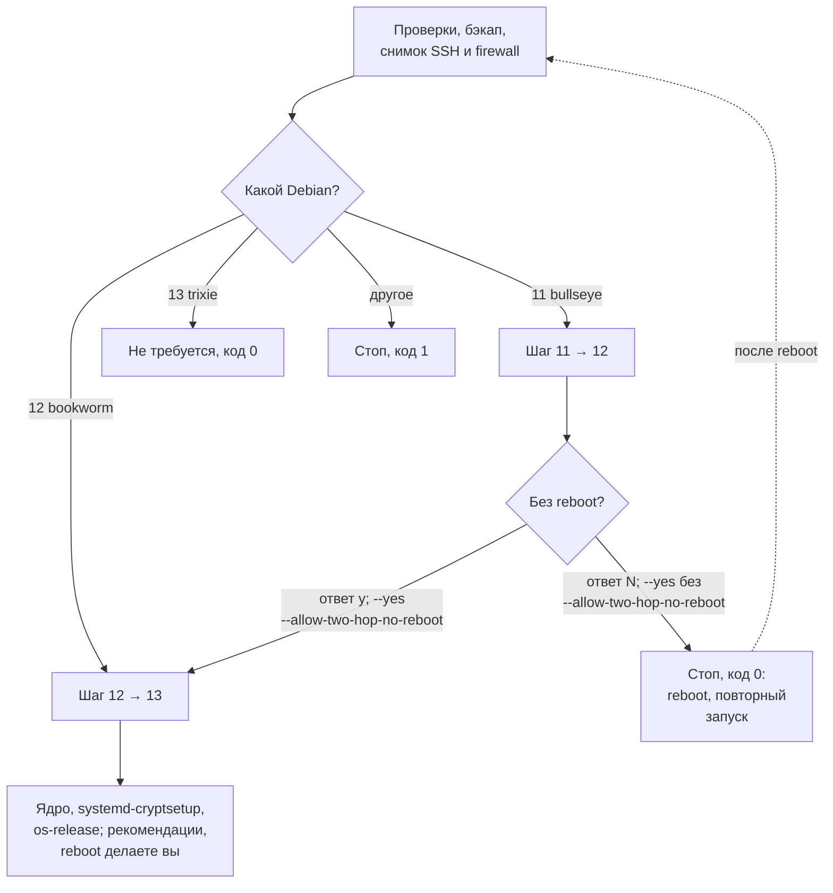

# Обновление Debian 11/12 до 13

[README](../README.md) · [Вся документация](README.md)

`upgrade-to-debian13.sh` обновляет серверную (минимальную) установку Debian 11 (bullseye) или Debian 12 (bookworm) до Debian 13 (trixie): делает бэкап, переписывает APT-источники в формате deb822, выполняет обновление по модели Release Notes и после каждого шага проверяет, что SSH остался доступен.

| Скрипт | Версия | Исходный Debian | Права | Лог |
|---|---|---|---|---|
| `upgrade-to-debian13.sh` | `2.0.3` (`SCRIPT_VERSION`) | 11 (bullseye) или 12 (bookworm) | root | `/var/log/debian-upgrade/upgrade-<TS>.log` |

> [!CAUTION]
> Перед запуском сделайте снимок (snapshot) машины или полный бэкап и убедитесь, что есть консольный доступ помимо SSH (serial console, VNC, rescue). Скрипт меняет APT-источники, пакеты, ядро и сервис `ssh`; его собственный бэкап в `/root/upgrade-backup-<TS>/` позволяет вернуть только файлы APT, SSH и firewall, но не состояние системы целиком. В SSH-сессии запускайте скрипт внутри `tmux` или `screen`.

## Содержание

- [Для чего](#для-чего)
- [Требования](#требования)
- [Быстрый старт](#быстрый-старт)
- [Параметры запуска](#параметры-запуска)
- [Маршрут обновления](#маршрут-обновления)
- [Что делает скрипт](#что-делает-скрипт)
- [Логи и бэкапы](#логи-и-бэкапы)
- [Проверка после запуска](#проверка-после-запуска)
- [Восстановление после сбоя](#восстановление-после-сбоя)
- [Решение проблем](#решение-проблем)
- [См. также](#см-также)

## Для чего

- Поднять существующий сервер до Debian 13 без переустановки, по шагам `12 → 13` или `11 → 12 → 13` (прямого перехода `11 → 13` в Debian нет).
- Довести до Debian 13 машину, на которой потом запускают [`optimize_vps.sh`](README_VPS.md), [`optimize_amnezia_host.sh`](README_AMNEZIA_HOST.md) или [`optimize_mini_pc.sh`](README_MINI_PC.md): они принимают Debian 12 и 13.
- Не для WSL2 (скрипт останавливается, если `/proc/version` содержит `microsoft` или `WSL`), не для не-Debian систем и не для i386.

## Требования

| Требование | Как проверяет скрипт |
|---|---|
| Debian 11 (bullseye) или 12 (bookworm) | `ID=debian` и `VERSION_CODENAME` в `/etc/os-release`; на trixie выходит с кодом 0 («обновление не требуется»), на других версиях останавливается |
| root | `EUID` равен 0, иначе код 1 |
| Серверная установка, не WSL | `/proc/version` без `microsoft` и `WSL` |
| Архитектура не i386 | `dpkg --print-architecture` |
| Свободное место | не меньше 5120 МБ на `/`; если смонтированы отдельно: 512 МБ на `/boot`, 2048 МБ на `/var/cache/apt/archives`, 4096 МБ на `/usr` |
| Здоровый dpkg | `dpkg --audit` ничего не выводит, нет пакетов в состоянии Half-Installed |
| Интернет | `deb.debian.org`, `security.debian.org` |
| По SSH — `tmux` или `screen` | без них (`STY`, `TMUX` не заданы в SSH-сессии) скрипт предупреждает и просит подтвердить продолжение |

Для подтверждений нужен терминал на stdin. Без терминала и без `--yes` скрипт останавливается: «Требуется интерактивный терминал для подтверждения».

## Быстрый старт

Команды запускают текущую версию из `main`. Выполняйте от root на целевой машине.

```bash
# Быстрый запуск (bash + curl)
bash <(curl -fsSL https://raw.githubusercontent.com/snaplyze/optimize-debian/main/upgrade-to-debian13.sh)

# Или скачивание
wget https://raw.githubusercontent.com/snaplyze/optimize-debian/main/upgrade-to-debian13.sh
chmod +x upgrade-to-debian13.sh

# Интерактивный режим
sudo ./upgrade-to-debian13.sh

# Автоматический режим без подтверждений.
# На Debian 11 скрипт остановится после 11 -> 12 и попросит reboot.
sudo ./upgrade-to-debian13.sh --yes

# Только для лабораторных стендов: разрешить 11 -> 12 -> 13 без промежуточного reboot
sudo ./upgrade-to-debian13.sh --yes --allow-two-hop-no-reboot
```

Закрепленный выпуск вместо `main` (см. [Версии и выпуски](../README.md#версии-и-выпуски)):

```bash
TAG=v2026.10.21.1   # последний выпуск: https://github.com/snaplyze/optimize-debian/releases/latest
bash <(curl -fsSL "https://raw.githubusercontent.com/snaplyze/optimize-debian/$TAG/upgrade-to-debian13.sh")
```

Справка без root и без изменений: `bash upgrade-to-debian13.sh --help` (флаги и строка `Версия: 2.0.3`).

## Параметры запуска

Флаги (`parse_args`):

| Флаг | Действие |
|---|---|
| `--yes`, `-y` | Все подтверждения отвечаются «да» (`AUTO_YES=true`). На Debian 11 после шага `11 → 12` скрипт останавливается с кодом 0 и просит перезагрузку |
| `--allow-two-hop-no-reboot` | Вместе с `--yes` продолжает `12 → 13` сразу после `11 → 12` без перезагрузки. Без `--yes` флаг ничего не меняет: вопрос задается интерактивно |
| `--help`, `-h` | Печатает справку и строку `Версия: 2.0.3`, выходит с кодом 0; root не нужен |
| любой другой | «Неизвестный аргумент», код 1 |

Переменные окружения, которые скрипт читает:

| Переменная | Умолчание | Назначение |
|---|---|---|
| `LOG_DIR` | `/var/log/debian-upgrade` | Каталог логов |
| `LOG_FILE` | `${LOG_DIR}/upgrade-<TS>.log` | Файл лога; `<TS>` — UTC, формат `ГГГГММДД-ЧЧММССZ` |
| `BKP_DIR` | `/root/upgrade-backup-<TS>` | Каталог бэкапа |
| `SSH_CONNECTION`, `SSH_CLIENT` | — | Признак удаленной сессии: включает проверку актуальности `openssh-*` перед `12 → 13` и требует работающий `ssh` после каждого шага |
| `STY`, `TMUX` | — | Признак `screen`/`tmux` в SSH-сессии |

Пути `/etc/apt`, `/var/lib/dpkg/status`, `/var/lib/apt/extended_states` и `/etc/os-release` из окружения не подменяются (их переопределяют только тесты после `source`). На время работы скрипт экспортирует `DEBIAN_FRONTEND=noninteractive`, `NEEDRESTART_MODE=a`, `NEEDRESTART_SUSPEND=1`.

## Маршрут обновления



- Debian 12: один шаг `bookworm → trixie`.
- Debian 11: шаг `bullseye → bookworm`, затем шаг `bookworm → trixie`. Между шагами скрипт рекомендует перезагрузку: ядро Debian 12 активно только после нее. С `--yes` без `--allow-two-hop-no-reboot` скрипт останавливается после первого шага; перезагрузите машину и запустите его снова — он увидит `bookworm` и продолжит с `12 → 13`. Интерактивно вопрос задается явно; ответ «N» тоже завершает работу с кодом 0.
- `--allow-two-hop-no-reboot` — для лабораторных стендов, не для production.
- Перезагрузку после последнего шага скрипт не делает: ее выполняете вы.

## Что делает скрипт

Порядок `main`:

1. Разбирает аргументы, проверяет root, открывает лог (`tee` в `LOG_FILE`).
2. Проверяет, что это не WSL, определяет версию Debian и просит подтвердить маршрут; проверяет архитектуру, `screen`/`tmux`, свободное место, `dpkg --audit`.
3. Бэкап (`backup_state`): `sources.list`, `sources.list.d`, `preferences`, `preferences.d`, `/var/lib/dpkg/status`, `/var/lib/apt/extended_states` копируются `cp -a`; если обязательная копия не удалась, скрипт останавливается до любых изменений и называет файл. Дополнительно сохраняет `dpkg --get-selections`, `apt-cache policy`, `uname -a`, `ip -br addr`, список работающих сервисов.
4. Предупреждает о DSA-ключах (`ssh-dss`) в `authorized_keys` root и пользователей `/home/*`: OpenSSH в Debian 13 их не принимает.
5. Снимок SSH и firewall (`snapshot_remote_access_state`): копия `/etc/ssh`, `authorized_keys`, `systemctl cat ssh`, статус и `ss -tlnp`; конфиги и состояние `ufw`, `nftables`, `netfilter-persistent`/`iptables-persistent`, `firewalld`. Ожидаемые порты SSH берутся из `sshd -T` (строки `port` и `listenaddress`), при его сбое — из портов, которые слушает процесс `sshd`. Если порты определить нельзя, а SSH нужен (сервис включен, активен или сессия удаленная), скрипт останавливается до изменений: порт 22 не подставляется.
6. Отмечает как установленные вручную (`apt-mark manual`) `openssh-server`, `ufw`, `nftables`, `netfilter-persistent`, `iptables-persistent`, `firewalld`, чтобы `autoremove` их не удалил.
7. Предварительная санитизация источников (`preflight_sanitize_apt_sources`, манифест `manifest-preflight.tsv`): сторонние репозитории, `backports`, `proposed-updates` (см. ниже). Затем `apt-get update` и установка `ca-certificates curl wget gnupg lsb-release debian-archive-keyring apt-utils`.
8. Один или два шага обновления (`do_upgrade_step`), у каждого свой манифест `manifest-<from>-to-<to>.tsv`:
   1. hold-пакеты: показывает `apt-mark showhold` и предлагает снять hold;
   2. APT pinning: при `Pin:`/`Pin-Priority` в `preferences*` предлагает перенести файлы в `<BKP_DIR>/apt-pins/`;
   3. санитизация источников (см. ниже);
   4. обновление текущего релиза до последней точечной версии: `apt-get update`, `upgrade`, `dist-upgrade` с `--force-confdef --force-confold` (локальные conffiles сохраняются);
   5. в удаленной сессии перед `12 → 13` доводит `openssh-client` и `openssh-server` до candidate-версии bookworm;
   6. запись источников deb822 (см. ниже), `apt-get update` и проверка, что в `apt-cache policy` не осталось старого релиза (смотрятся адреса источников и `n=<кодовое имя>` в строках `release`, закрепленные версии пакетов не учитываются); иначе остановка до установки пакетов;
   7. с этого места фаза `packages`: `apt-get install apt dpkg`, `apt-get upgrade` (минимальное обновление), `apt-get full-upgrade`; при сбое full-upgrade повторяется с `-o APT::Immediate-Configure=0`;
   8. `apt-get autoremove`, `autoclean`, `dpkg --purge` остаточных конфигов (`rc`);
   9. firewall: пропавшие пакеты `ufw`/`nftables`/`netfilter-persistent`/`firewalld` ставятся заново, включенные до обновления сервисы включаются снова, `/etc/nftables.conf` проверяется `nft -c`;
   10. SSH (`ensure_ssh_is_healthy`): пропавший `openssh-server` ставится заново; `sshd -t` обязан пройти; если сервис был включен или активен, он включается и перезапускается; если SSH нужен (сервис был включен, активен или сессия удаленная), сервис обязан быть активен и слушать хотя бы один из ожидаемых портов, иначе остановка;
   11. `VERSION_CODENAME` в `/etc/os-release` обязан совпасть с целевым релизом.
9. После последнего шага: проверка kernel meta-package (`linux-image-amd64`, `linux-image-arm64`, `linux-image-cloud-amd64`; если нет ни одного — `apt-get install linux-image-<arch>`), `systemd-cryptsetup` при непустом `/etc/crypttab`, итоговая проверка `VERSION_CODENAME=trixie` и рекомендации. В интерактивном режиме скрипт ждет Enter перед выходом.

Санитизация источников (и перед первым `apt-get update`, и в начале каждого шага):

- Сторонние репозитории: файлы `sources.list.d/*.list` и `*.sources`, где хотя бы один адрес не на `deb.debian.org` или `security.debian.org`, переносятся в `/etc/apt/sources.list.d.disabled-<TS>/`.
- `backports`: строки удаляются из `sources.list` и `*.list` (`sed -i.bak`, рядом остается копия `.bak`); в `*.sources` из поля `Suites` убираются только суиты с `backports`, строфа без суит удаляется целиком.
- `proposed-updates`: строки удаляются из `sources.list` и `*.list` (`sed -i`, без копии `.bak`); в `*.sources` — так же, как для `backports`.
- Файл `.sources` переписывается через временный файл в том же каталоге (суффикс `.disabled`, APT его не читает); права и владелец копируются с исходного файла `chmod --reference`/`chown --reference`, затем атомарный `mv`. Если файл не изменился, он не трогается.

Запись источников для целевого релиза (`write_sources_deb822`):

- Непустой `/etc/apt/sources.list` переносится в `<BKP_DIR>/moved-sources/`, на его месте остается пустой файл.
- Официальные файлы `sources.list.d/*.list` и `*.sources` с кодовым именем старого релиза (например, `security.list` с `bookworm-security`) переносятся в `moved-sources/`: иначе рядом с новым релизом остались бы источники старого. Прежний `debian.sources` переносится туда же.
- Создается `/etc/apt/sources.list.d/debian.sources`: `https://deb.debian.org/debian` с суитами `<codename> <codename>-updates` и `https://deb.debian.org/debian-security` с суитой `<codename>-security`; компоненты `main contrib non-free non-free-firmware`; `Signed-By: /usr/share/keyrings/debian-archive-keyring.gpg`.
- Каждый перенос и созданный файл записываются в манифест шага (строки `moved <путь> <копия>` и `created <путь>`).

Скрипт не переписывает сетевую конфигурацию под конкретный облачный образ: сетевые проблемы после перезагрузки диагностируются отдельно (см. [Решение проблем](#решение-проблем)).

## Логи и бэкапы

| Что | Где |
|---|---|
| Лог запуска | `/var/log/debian-upgrade/upgrade-<TS>.log` (stdout и stderr через `tee`) |
| Бэкап запуска | `/root/upgrade-backup-<TS>/` |
| Отключенные сторонние репозитории | `/etc/apt/sources.list.d.disabled-<TS>/` |
| Копии `.bak` после удаления `backports` | рядом с `sources.list` и `*.list` |

Состав `/root/upgrade-backup-<TS>/`:

| Путь | Содержимое |
|---|---|
| `sources.list`, `sources.list.d/`, `preferences`, `preferences.d/` | копии на момент запуска (если существовали) |
| `status`, `extended_states` | `/var/lib/dpkg/status`, `/var/lib/apt/extended_states` |
| `dpkg-selections.txt`, `apt-policy.txt`, `uname.txt`, `network.txt`, `services.txt` | `dpkg --get-selections`, `apt-cache policy`, `uname -a`, `ip -br addr`, работающие сервисы |
| `ssh/ssh/`, `ssh/authorized_keys/` | копия `/etc/ssh` и `authorized_keys` по исходным путям (если установлен `openssh-server`) |
| `ssh/sshd-T.before.txt`, `ssh/ssh.service.txt`, `ssh/ssh.status.before.txt`, `ssh/ss.before.txt` | состояние SSH до обновления |
| `ssh/ssh.status.after.txt`, `ssh/ss.after.txt` | состояние SSH после проверки шага |
| `firewall/` | `ufw/`, `nftables.conf`, `iptables/`, `firewalld/`, снимки `ufw status verbose`, `nft list ruleset`, `iptables-save`, `ip6tables-save`, `firewall-cmd --state` (только для установленных пакетов) |
| `moved-sources/` | перенесенные `sources.list`, `debian.sources` и официальные файлы старого релиза |
| `apt-pins/` | перенесенные файлы pinning (по подтверждению) |
| `manifest-preflight.tsv`, `manifest-bullseye-to-bookworm.tsv`, `manifest-bookworm-to-trixie.tsv` | манифесты переносов: `<действие>\t<путь>\t<копия>` |

Проверка бэкапа до того, как полагаться на него:

```bash
ls -la /root/upgrade-backup-*/
cat /root/upgrade-backup-*/manifest-*.tsv
diff -r /etc/ssh /root/upgrade-backup-*/ssh/ssh && echo "ssh: без изменений"
```

Каждый запуск создает новый каталог с новым `<TS>` (например, после перезагрузки между шагами); манифесты прежнего запуска остаются в его каталоге.

## Проверка после запуска

Сразу после завершения, до перезагрузки:

```bash
grep -E '^(PRETTY_NAME|VERSION_CODENAME)' /etc/os-release   # Debian 13, trixie
sshd -t && systemctl status ssh --no-pager && ss -tlnp | grep sshd
cat /etc/apt/sources.list.d/debian.sources
ls /etc/apt/sources.list.d.disabled-*/ 2>/dev/null           # отключенные сторонние репозитории
```

Откройте вторую SSH-сессию и убедитесь, что вход работает, прежде чем закрывать первую. Затем `reboot` и после перезагрузки:

```bash
uname -r              # ядро Debian 13
cat /etc/os-release
systemctl --failed
```

Нужные сторонние репозитории верните из `sources.list.d.disabled-<TS>/` по одному, уже под trixie. При необходимости добавьте `trixie-backports`.

## Восстановление после сбоя

При ненулевом выходе скрипт печатает подсказку, которая зависит от фазы текущего шага (`UPGRADE_PHASE`); она попадает и в лог.

- **До изменений APT** (проверки, бэкап, снимок SSH): подсказки нет, система не изменена. Устраните причину из сообщения и запустите скрипт снова.
- **Фаза `sources`** (санитизация, запись `debian.sources`, `apt-get update`, проверка `apt-cache policy`): пакеты нового релиза не ставились. Скрипт печатает путь бэкапа, полные копии `sources.list` и `sources.list.d` на момент запуска и команду возврата файлов, перенесенных на этом шаге, по его манифесту. Завершенные шаги в подсказку не входят. Пример для шага `12 → 13`:

  ```bash
  tac /root/upgrade-backup-<TS>/manifest-bookworm-to-trixie.tsv | while IFS=$'\t' read -r action src dst; do case "$action" in moved) [ -e "$dst" ] && mv -f -- "$dst" "$src" ;; created) rm -f -- "$src" ;; esac; done
  apt-get update
  ```

  Если на шаге ничего не переносилось, скрипт сообщает, что манифест не создан.
- **Фаза `packages`** (`apt-get upgrade`/`full-upgrade` нового релиза и дальше, включая проверки firewall и SSH): команды возврата нет. Источники старого релиза возвращать нельзя: система уже частично обновлена. Устраните причину и завершите обновление вручную: `apt-get -f install && apt-get full-upgrade`, затем `sshd -t && systemctl status ssh && ss -tlnp`. Перезапуск скрипта поможет, только если `/etc/os-release` еще показывает старый релиз: иначе скрипт решит, что обновление не требуется, и не выполнит `full-upgrade` и проверки SSH.
- После успешного завершения шага подсказка не печатается.

Файлы SSH и firewall возвращаются вручную из `ssh/ssh/` и `firewall/` бэкапа (например, `cp -a /root/upgrade-backup-<TS>/ssh/ssh/sshd_config /etc/ssh/` и `sshd -t`). Полный откат релиза Debian не предусмотрен: для него нужен снимок машины.

## Решение проблем

| Сообщение или симптом | Что делать |
|---|---|
| `Недостаточно места на /` (или `/boot`, `/var/cache/apt/archives`, `/usr`) | `apt clean && apt autoremove`, удалите старые ядра; пороги см. в [Требованиях](#требования) |
| `dpkg --audit обнаружил проблемы` / `Half-Installed` | `dpkg --configure -a`, `apt-get install -f`, затем запуск снова |
| `Требуется интерактивный терминал для подтверждения` | Запускайте из терминала или с `--yes` |
| `Не удалось определить порты SSH` | `sshd -t`, `systemctl status ssh`; скрипт не стартует, пока `sshd -T` не отработает или `sshd` не начнет слушать порт |
| `В apt-cache policy остался старый релиз` | Найдите файл: `grep -rlE 'bookworm\|oldstable' /etc/apt/sources.list /etc/apt/sources.list.d/`; перенесенные файлы в `moved-sources/`, манифест в подсказке |
| `full-upgrade не удался, пробуем с APT::Immediate-Configure=0` | Это автоматический повтор; вмешательство нужно, только если упал и он |
| `openssh-server пропал после обновления — переустановка` | Скрипт ставит пакет сам; дальше проверяет `sshd -t` и порты |
| `ssh активен, но не слушает ожидаемые порты` | Сравните `/etc/ssh` с `ssh/ssh/` в бэкапе и `ssh/sshd-T.before.txt`; после правки `systemctl restart ssh` |
| `Обнаружены DSA SSH-ключи` | Добавьте Ed25519/ECDSA/RSA ключ в `authorized_keys` до перезагрузки: OpenSSH в Debian 13 `ssh-dss` не принимает |
| `--yes не продолжает Debian 11 → 12 → 13 без промежуточного ребута` | Так задумано: `reboot`, затем тот же запуск — скрипт продолжит с `12 → 13` |
| `Система уже на Debian 13 (trixie)` при незавершенном обновлении | Завершите вручную: `apt-get -f install && apt-get full-upgrade`, проверьте SSH |
| Нестандартный порт SSH | Скрипт берет порты из `sshd -T` и после каждого шага проверяет, что один из них слушается |

Cloud VM / Yandex Cloud:

- Скрипт не правит cloud networking. Если после перезагрузки `networking.service` в состоянии failed, а обновление завершилось успешно, это особенность образа или VM: сравните состояние с чистым образом и диагностируйте `networking.service`, `ifup@eth0.service` и `cloud-init` уже на Debian 13.
- Если после перезагрузки пропал SSH, сначала проверьте `cloud-init status --long`, `ip -br addr`, `ip route` и доступность metadata на `169.254.169.254`.
- Если metadata недоступна, SSH-ключи могут не примениться. Восстановите штатную сетевую конфигурацию образа или используйте rescue/serial доступ, а не скрипт обновления.
- Для Yandex Cloud основной канал восстановления — serial console / serial-port output. При полной потере сети восстанавливайте boot disk через rescue VM.
- Осторожно с `yc compute instance update --metadata ...`: операция перезаписывает весь metadata payload и может затереть существующие `user-data` / `ssh-keys`, если не передать их заново.

## См. также

- [README](../README.md) — обзор всех скриптов репозитория и [Версии и выпуски](../README.md#версии-и-выпуски)
- [Вся документация](README.md)
- [VPS](README_VPS.md) — оптимизация VPS после перехода на Debian 13
- [AmneziaVPN host](README_AMNEZIA_HOST.md) — подготовка хоста под AmneziaVPN
- [Mini PC](README_MINI_PC.md) — настройка mini-PC после обновления
- [WSL2](README_WSL2.md) — настройка среды WSL2 (этот скрипт в WSL2 не работает)
- [Устройство репозитория](ARCHITECTURE.md) — как устроен скрипт и его тесты (`tests/test_upgrade_to_debian13.sh`)
- [SECURITY.md](../SECURITY.md) — как сообщить об уязвимости
