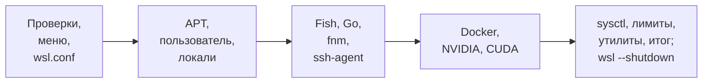

# Оптимизация WSL2

[README](../README.md) · [Вся документация](README.md)

`optimize_wsl2.sh` настраивает дистрибутив Debian 12 или 13 под WSL2 как рабочую станцию разработчика: включает systemd через `/etc/wsl.conf`, ставит Fish + Starship, Go, Node.js через fnm, Docker CE, по выбору NVIDIA Container Toolkit и CUDA Toolkit, применяет sysctl и лимиты под ML/AI-нагрузки. Руководство для администратора, который запускает скрипт от root внутри дистрибутива.

| Скрипт | Версия | Debian | Права | Лог |
|---|---|---|---|---|
| `optimize_wsl2.sh` | 4.1.0 (`SCRIPT_VERSION`) | 12 (bookworm) или 13 (trixie) под WSL2 | root (`sudo`) | `/var/log/wsl2_optimization.log` |

> [!WARNING]
> Скрипт меняет систему: пакеты, пользователей и `/etc/sudoers.d/`, `/etc/wsl.conf`, sysctl, лимиты, `~/.bashrc` и конфигурацию Fish у root и выбранного пользователя. Запускайте его только внутри WSL2-дистрибутива Debian 12/13: на другом Debian — выход с кодом 1 до шагов, но уже после загрузки `gum` (если его не было) и создания лога; в WSL1 или без root — до любых изменений. Перед запуском сохраните дистрибутив из PowerShell: `wsl --export <Дистрибутив> D:\wsl-backups\debian.tar` (имя дистрибутива показывает `wsl -l -v`). Восстановление: `wsl --import <Имя> <Каталог> D:\wsl-backups\debian.tar`.

## Содержание

- [Для чего](#для-чего)
- [Требования](#требования)
- [Быстрый старт](#быстрый-старт)
- [Параметры запуска](#параметры-запуска)
- [Что делает скрипт](#что-делает-скрипт)
- [Файлы, которые пишет скрипт](#файлы-которые-пишет-скрипт)
- [Проверка после запуска](#проверка-после-запуска)
- [Повторный запуск и откат](#повторный-запуск-и-откат)
- [Решение проблем](#решение-проблем)
- [См. также](#см-также)

## Для чего

- **systemd в WSL2** — `/etc/wsl.conf` с `systemd=true`, Windows-диски в `/mnt`, interop с Windows и общий PATH.
- **Fish + Starship** — Fish с пресетом Starship `nerd-font-symbols`, хук `fnm env --use-on-cd --shell fish`, функции `explorer`, `cmd`, `powershell`, `wslperf`, `mkcd`. Шелл в `/etc/passwd` остается `/bin/bash` ради WSL interop, VSCode Remote и скриптов; интерактивные сессии переходят в Fish через `~/.bashrc`.
- **Языки** — Go закрепленной версии (1.27.3) с проверкой SHA-256 и Node.js LTS через fnm (1.39.0) в домашнем каталоге пользователя, поэтому `npm install -g` работает без sudo. Go и Node.js включаются в меню независимо.
- **Контейнеры и GPU** — Docker CE с Compose и BuildKit из официального репозитория Docker в формате deb822; по выбору NVIDIA Container Toolkit и CUDA Toolkit через `cuda-keyring` без широкого метапакета `cuda`.
- **Производительность** — буферы TCP до 64 MB, BBR, `vm.swappiness = 1`, `memlock unlimited`, `nofile 524288`, `nproc 131072`, Transparent Huge Pages, планировщики ввода-вывода для NVMe и SSD.
- **Обслуживание** — автоматические обновления безопасности, лимиты journald, утилиты `wsl2-monitor.sh`, `wsl2-cleanup.sh`, `wsl2-backup.sh`.

Скрипт [`upgrade-to-debian13.sh`](README_UPGRADE.md) рассчитан на серверные установки и не предназначен для WSL2. Для WSL используйте дистрибутив Debian 12 или 13.

## Требования

### Windows

- Windows 10/11 с WSL2. В PowerShell от имени администратора:

```powershell
wsl --update
wsl --set-default-version 2
```

- Для GPU: драйвер NVIDIA с поддержкой WSL, установленный в Windows. Внутри дистрибутива должны быть `/dev/dxg` и `nvidia-smi`; скрипт проверяет их и предупреждает, но не останавливается.
- Лимиты памяти и CPU задает файл `%USERPROFILE%\.wslconfig`. Пример (скрипт в итоговых подсказках советует `memory`, `processors`, `autoMemoryReclaim=dropCache`, `sparseVhd=true`):

```ini
[wsl2]
memory=8GB
processors=4
swap=2GB
dnsTunneling=true
networkingMode=mirrored
guiApplications=true

[experimental]
autoMemoryReclaim=dropCache
sparseVhd=true
```

После правки `.wslconfig` нужен `wsl --shutdown`. Минимум 4 GB RAM для дистрибутива; тюнинг sysctl рассчитан на 32 GB.

### Дистрибутив

- Debian 12 или 13 из `/etc/os-release` (`ID=debian`, `VERSION_ID` 12 или 13). Другая версия или другой дистрибутив — выход с кодом 1.
- Ядро WSL2: `/proc/sys/kernel/osrelease` содержит `wsl2` или `microsoft-standard-WSL2`. WSL1 не поддерживается.
- Root: `sudo` или вход под root. Доступ в интернет к `deb.debian.org`, `download.docker.com`, `github.com`, `dl.google.com`, `nvidia.github.io` и `developer.download.nvidia.com` (последние два — только для NVIDIA/CUDA).
- Интерактивный терминал: меню задает вопросы, пароль нового пользователя вводится вручную.

## Быстрый старт

```bash
# Быстрый запуск (bash + curl)
bash <(curl -fsSL https://raw.githubusercontent.com/snaplyze/optimize-debian/main/optimize_wsl2.sh)

# Или скачайте скрипт
wget https://raw.githubusercontent.com/snaplyze/optimize-debian/main/optimize_wsl2.sh

# Сделайте исполняемым
chmod +x optimize_wsl2.sh

# Запустите от имени root
sudo ./optimize_wsl2.sh
```

Все шаги идут из функции `optimize_main`, вызванной последней строкой: оборванная загрузка через `bash <(curl ...)` останавливается на синтаксической ошибке и ничего не меняет. Если скрипт лежит в `/home/<пользователь>/`, после запуска через sudo он возвращает файлу владельца.

Закрепленный выпуск вместо `main` (см. [Версии и выпуски](../README.md#версии-и-выпуски)):

```bash
TAG=v2026.10.21   # последний выпуск: https://github.com/snaplyze/optimize-debian/releases/latest
bash <(curl -fsSL "https://raw.githubusercontent.com/snaplyze/optimize-debian/$TAG/optimize_wsl2.sh")
```

После завершения выполните в PowerShell `wsl --shutdown` и откройте дистрибутив заново: только тогда применяются `/etc/wsl.conf`, systemd и пользователь по умолчанию.

## Параметры запуска

### Аргументы

| Аргумент | Действие | Код выхода |
|---|---|---|
| `-h`, `--help` | Печатает справку, ничего не меняет, root не нужен | 0 |
| без аргументов | Полный запуск с интерактивным меню | 0; 1 при ошибке проверки до меню; при ошибке шага — код упавшей команды |
| любой другой | `Unknown argument: ...` и справка в stderr | 2 |

Ошибка внутри шага печатает `Script failed at line N with exit code M` и завершает скрипт с кодом команды, которая упала (`trap ... ERR`).

### Интерактивное меню

Меню — Charmbracelet `gum` (`gum confirm`): если `gum` нет, скрипт скачивает закрепленную версию 0.17.0 в `/usr/local/bin/gum` с проверкой SHA-256; без `gum` работают обычные вопросы `[Y/n]` в Bash. `dialog` и `whiptail` автоматически не выбираются. Enter принимает умолчание.

| Вопрос | Умолчание | Переменная | Что включает |
|---|---|---|---|
| Configure WSL2 (wsl.conf with systemd) | да | `CONFIGURE_WSL_CONF` | Шаг 3 |
| Update system packages | да | `UPDATE_SYSTEM` | Шаг 4 |
| Install base utilities (git, neovim, tmux, etc.) | да | `INSTALL_BASE_UTILS` | Шаг 4 |
| Create new user with sudo rights | нет | `CREATE_USER` | Шаг 5 |
| Configure locales (ru_RU, en_US) | да | `CONFIGURE_LOCALES` | Шаг 6 |
| Install Fish + Starship | да | `INSTALL_FISH` | Шаг 7 |
| Configure ssh-agent | да | `CONFIGURE_SSH_AGENT` | Шаг 10 |
| Install Go (latest stable) | да | `INSTALL_GO` | Шаг 8 |
| Install Node.js (LTS via fnm) | да | `INSTALL_NODE` | Шаг 9 |
| Install Docker CE | да | `INSTALL_DOCKER` | Шаг 11 |
| Install NVIDIA Container Toolkit + CUDA support | нет | `INSTALL_NVIDIA` | Шаг 12 |
| Install full CUDA Toolkit (только если выбран NVIDIA) | да | `INSTALL_CUDA` | Шаг 12 |
| Enable automatic security updates | да | `ENABLE_AUTO_UPDATES` | Шаг 14 |
| Apply performance tuning | да | `PERFORMANCE_TUNING` | Шаг 13 |
| Configure systemd-journald limits (100MB disk + 50MB RAM) | да | `CONFIGURE_JOURNALD` | Шаг 16 |

Вопрос «Install Go (latest stable)» ставит закрепленную в скрипте версию Go 1.27.3, а не последнюю с сайта. Шаги без вопроса выполняются всегда: проверки, настройка Bash (7.5), утилиты (15), финальная очистка (17).

Внутри шагов есть еще вопросы: имя нового пользователя и его пароль (шаг 5), смена пароля существующего пользователя, локаль по умолчанию (шаг 6: `1` en_US.UTF-8, `2` ru_RU.UTF-8, `3` обе с английской по умолчанию; обе локали генерируются при любом выборе).

### Переменные окружения

| Переменная | Умолчание | Действие |
|---|---|---|
| `TUI_BACKEND` | `auto` | `gum`, `plain`, `dialog` или `whiptail`; `auto` — `gum`, если он есть или скачался, иначе `plain` |
| `TUI_AUTO_INSTALL_GUM` | `true` | `false` запрещает скачивать `gum` |
| `GUM`, `TUI_GUM_BIN` | `/usr/local/bin/gum` | Путь к бинарнику `gum` (куда ставить и какой использовать) |
| `TUI_GUM_VERSION` | `0.17.0` | Версия `gum`; SHA-256 записана только для 0.17.0, другая версия не скачивается |
| `SUDO_USER` | задает `sudo` | Без создания пользователя этот пользователь получает Fish, Bash, fnm, группу `docker` и ssh-agent; если его нет — первый пользователь с UID >= 1000, иначе root |
| `WSL_DISTRO_NAME` | задает WSL | Один из признаков WSL при проверке окружения |
| `COMMON_DOWNLOAD_CONNECT_TIMEOUT`, `COMMON_DOWNLOAD_MAX_TIME`, `COMMON_DOWNLOAD_RETRIES` | 20, 900, 3 | Таймауты и повторы `curl` для загрузок Go, fnm, Starship, ключей и `cuda-keyring` |
| `COMMON_STARSHIP_BIN` | `/usr/local/bin/starship` | Куда ставить Starship, если нет пакета Debian |
| `OPTIMIZE_SOURCE_ONLY` | `0` | `1` — только загрузить функции без запуска (для тестов) |

Параметры APT (`COMMON_APT_LOCK_TIMEOUT=300`, `COMMON_APT_UPDATE_RETRY_DELAY=10`, `COMMON_APT_UPDATE_ATTEMPTS=30`) заданы в скрипте и из окружения не меняются. На время работы скрипт выставляет `LC_ALL=C`, `LANG=C` и `DEBIAN_FRONTEND=noninteractive`.

## Что делает скрипт

Порядок соответствует `optimize_main`. Шаги с systemd (`systemctl`) выполняются сразу, только если systemd уже активен и `/etc/wsl.conf` в этом запуске не переписывался; иначе действие откладывается и попадает в список «After-restart checklist» в конце.



Перед шагами: разбор аргументов; `EUID` должен быть 0; `/proc/version` содержит `microsoft` или задана `WSL_DISTRO_NAME`; ядро WSL2 по `/proc/sys/kernel/osrelease`. Затем `tui_init` (поиск или загрузка `gum`) и баннер.

1. **System Detection.** Читает `/etc/os-release`; требует `ID=debian` и версию 12 или 13.
2. **Меню** из таблицы выше, затем сводка выбранного профиля.
3. **WSL2 Configuration.** Существующий `/etc/wsl.conf` копируется (`cp -p`) в `/etc/wsl.conf.backup.<ГГГГ-ММ-ДД-ЧЧММСС>`, затем пишется новый без секции `[user]`. С этого момента `systemctl`-действия откладываются до `wsl --shutdown`.
4. **System Update & Packages.** В каждый источник APT с `main` добавляются `contrib`, `non-free`, `non-free-firmware` (строки `deb` и поля `Components:` в deb822). `apt-get update` с проверкой вывода: ошибки загрузки, подписи (в том числе просроченный или неизвестный ключ) или `not live until` (часы WSL отстали) отклоняют обновление индекса; затем `apt-get upgrade -y`. Базовые утилиты ставятся через `common_safe_install`: недоступный пакет дает предупреждение, а не остановку.

   <details><summary>Базовые пакеты</summary>

   `curl`, `git`, `htop`, `build-essential`, `cmake`, `python3`, `python3-pip`, `python3-venv`, `fzf`, `ripgrep`, `fd-find`, `tree`, `jq`, `file`, `ncdu`, `unzip`, `zip`, `xz-utils`, `gnupg`, `ca-certificates`, `lsb-release`, `bc`, `neovim`, `tmux`, плюс `fastfetch`, если есть в репозитории, иначе `neofetch`, иначе ничего. Если есть `fdfind` без `fd` (и `batcat` без `bat`), создается ссылка в `/usr/local/bin`.
   </details>

5. **User Management.** При `CREATE_USER`: имя запрашивается до тех пор, пока не пройдет проверку (строчные буквы, цифры, `_`, `-`; первый символ — буква или `_`; не только цифры; до 32 символов). Существующий пользователь остается, предлагается сменить пароль и он добавляется в `sudo`; новый создается `adduser --disabled-password`, добавляется в `sudo`, пароль задается `passwd` с повтором при ошибке. Затем `/etc/sudoers.d/<пользователь>` с `NOPASSWD:ALL` через временный файл и `visudo -cf` (при ошибке прежний файл не трогается), проверка домашнего каталога, и, если выбран шаг 3, `/etc/wsl.conf` переписывается с `[user] default=<пользователь>`. Без создания пользователя целевой пользователь — `SUDO_USER`, иначе первый с UID >= 1000, иначе root.
6. **System Localization.** Пакет `locales`; выбор локали по умолчанию; в `/etc/locale.gen` включаются `en_US.UTF-8` и `ru_RU.UTF-8`, `locale-gen --keep-existing`; `update-locale --reset LANG=<локаль> LANGUAGE=<язык>` (Debian 12 — `/etc/default/locale`, Debian 13 — `/etc/locale.conf`); `/etc/profile.d/locale.sh` с теми же переменными. `LC_ALL` не задается. Окружение самого скрипта остается в `C`.
7. **Fish + Starship.** Пакеты `fish`, `curl`. Starship — пакет Debian, если он есть в репозитории (Debian 13), иначе закрепленный релиз 1.27.0 с GitHub (amd64, arm64) с проверкой SHA-256 в `/usr/local/bin/starship`. Для root, нового и целевого пользователя: `~/.config/starship.toml` (`starship preset nerd-font-symbols`) и `~/.config/fish/config.fish`. Если `fish` после установки не найден — выход с кодом 1.

   **Bash Modernization** (всегда, без вопроса в меню; в коде шаг 7.5). Пакет `bash-completion`; `~/.bashrc` тех же пользователей заменяется профилем WSL2. Чужой `.bashrc` (без первой строки `# WSL2 Optimized Bash Configuration`) сначала копируется в `~/.bashrc.backup.<ГГГГММДД_ЧЧММСС>.<суффикс>`; свой перезаписывается без новой копии. Интерактивный Bash без `SSH_ORIGINAL_COMMAND` делает `exec fish`; история 50000 строк, алиасы Docker/Git/системы, функции `explorer`, `cmd`, `powershell`, `wslperf`, `mkcd`, `extract`, хук `fnm env --use-on-cd --shell bash`.
8. **Go Installation.** Архив Go 1.27.3 (`dl.google.com`, amd64 или arm64) скачивается в каталог внутри `/usr/local`, сверяется с SHA-256 из скрипта, распаковывается и только потом заменяет `/usr/local/go`; при неудаче прежний каталог возвращается. Пишется `/etc/profile.d/golang.sh` (`PATH`, `GOPATH=$HOME/go`); блок Go дописывается в `/root/.bashrc` и в `.bashrc` пользователя, созданного в этом запуске (маркер `golang`, второй раз не дублируется). Ошибка Go — предупреждение, скрипт продолжается.
9. **Node.js Installation (fnm + LTS).** Нужны `curl` и `unzip` (доставляются при отсутствии). fnm 1.39.0 с GitHub (amd64, arm64) с проверкой SHA-256 ставится в `~/.local/share/fnm/fnm` root, нового и целевого пользователя; от имени пользователя (`su -`) выполняются `fnm install --lts --use`, `fnm default`, `corepack enable` при наличии. Миграции со старых менеджеров Node нет: шаг рассчитан на чистую систему.
10. **SSH Agent Configuration.** Пакет `openssh-client` и общий `/etc/profile.d/wsl2-ssh-agent.sh` (режим 644). Его читает любая login-оболочка (терминал WSL открывает login-bash) до `~/.profile`, поэтому агент наследуют и Bash, и Fish. Если `SSH_AUTH_SOCK` уже задан, файл ничего не делает; иначе берет каталог `$XDG_RUNTIME_DIR` (есть при systemd), а без него `${TMPDIR:-/tmp}/ssh-agent-<uid>` (создается с режимом 700), и использует его, только если это каталог пользователя, не символическая ссылка, а запасной вариант — с режимом 700; сокет — `<каталог>/ssh-agent.sock`. Новый агент запускается только когда `ssh-add -l` не может подключиться (код 2); если агент не смог создать сокет, `SSH_AUTH_SOCK` снимается. Сниппет ничего не печатает, не обрывает оболочку с `set -e` и не трогает `~/.ssh` (в WSL это часто ссылка на диск Windows, где unix-сокет не создается). Блок прежних версий (`# WSL2: автозапуск ssh-agent (без systemd)`) удаляется из `~/.bash_profile`, `~/.profile` и `~/.zprofile` целевого пользователя; `.bash_profile` и `.zprofile`, в которых кроме этого блока ничего не было, удаляются: их создавали прежние версии, из-за чего login-bash переставал читать `~/.profile` и `~/.bashrc` и автопереход в Fish пропадал. Символические ссылки пропускаются с предупреждением; оставшийся файл, созданный прежней версией от root, получает владельца домашнего каталога.
11. **Docker Installation.** Удаляются `docker.io`, `docker-doc`, `docker-compose`, `podman-docker`, `containerd`, `runc`. Ключ Docker скачивается и принимается только с отпечатком `9DC858229FC7DD38854AE2D88D81803C0EBFCD88` в `/etc/apt/keyrings/docker.asc`; источник `/etc/apt/sources.list.d/docker.sources` (deb822: `Suites: <кодовое имя>`, `Components: stable`, `Architectures: $(dpkg --print-architecture)`). Пакеты `docker-ce`, `docker-ce-cli`, `containerd.io`, `docker-buildx-plugin`, `docker-compose-plugin`; без бинарника `docker` — выход с кодом 1. Пишется `/etc/docker/daemon.json` (json-file 10m x 3, BuildKit). `systemctl enable --now docker` — сразу или после перезапуска WSL (см. выше). Группа `docker` создается, целевой пользователь (не root) добавляется в нее.
12. **NVIDIA Support Installation.** Проверка `/dev/dxg` и `nvidia-smi` — только предупреждения. Ключ NVIDIA с отпечатком `C95B321B61E88C1809C4F759DDCAE044F796ECB0` в `/usr/share/keyrings/nvidia-container-toolkit-keyring.gpg`, источник `/etc/apt/sources.list.d/nvidia-container-toolkit.list` (`https://nvidia.github.io/libnvidia-container/stable/deb/<arch>/`), пакет `nvidia-container-toolkit`. Если есть Docker: `nvidia-ctk runtime configure --runtime=docker` дописывает runtime `nvidia` в `daemon.json`, Docker останавливается и запускается заново (при активном systemd).

    **CUDA Toolkit** (при `INSTALL_CUDA`): репозиторий `debian12` или `debian13` по версии Debian, только `x86_64` (SHA-256 `cuda-keyring` записана для amd64). Включается `contrib` (`add-apt-repository contrib` или правка источников). `cuda-keyring_1.1-1_all.deb` скачивается с `developer.download.nvidia.com`, сверяется с SHA-256 из скрипта и ставится `dpkg -i`; при ошибке загрузки или индекса CUDA пропускается. Ставится первый доступный из `cuda-toolkit`, `cuda-toolkit-13`, `cuda-toolkit-13-2`, `cuda-toolkit-13-1`, `cuda-toolkit-13-0`, `cuda-toolkit-12-9`, `cuda-toolkit-12-8`, `cuda-toolkit-12-6`, `cuda-toolkit-12-5`, `cuda-toolkit-12-4`, `cuda-toolkit-12-3`; метапакет `cuda` не используется, так как тянет драйверы Linux, ненужные в WSL. Если существует `/usr/local/cuda` (установлен сейчас или раньше): `/etc/profile.d/cuda.sh` и блок CUDA в `.bashrc` root, нового и целевого пользователя (маркер `cuda/bin`); `config.fish` экспортирует `CUDA_HOME` и `LD_LIBRARY_PATH` сам, если каталог есть. Проверяется `nvcc --version`.
13. **Performance Tuning.** `/etc/security/limits.d/99-wsl2-limits.conf`; `/etc/sysctl.conf` создается, если отсутствует; `/etc/sysctl.d/99-wsl2-optimization.conf` применяется `sysctl -e -p` (параметры, которых нет в ядре WSL2, пропускаются). Transparent Huge Pages: `enabled=always`, `defrag=defer` — только до перезапуска, в файлы не пишется. `/etc/udev/rules.d/60-ioschedulers.conf` для NVMe и SSD.

    <details><summary>sysctl в /etc/sysctl.d/99-wsl2-optimization.conf</summary>

    | Параметр | Значение |
    |---|---|
    | `net.core.rmem_default`, `net.core.wmem_default` | 1048576 |
    | `net.core.rmem_max`, `net.core.wmem_max` | 67108864 |
    | `net.ipv4.tcp_rmem`, `net.ipv4.tcp_wmem` | 4096 524288 67108864 |
    | `net.core.netdev_max_backlog` | 32768 |
    | `net.core.somaxconn` | 16384 |
    | `net.ipv4.tcp_max_syn_backlog` | 32768 |
    | `net.core.default_qdisc` | fq |
    | `net.ipv4.tcp_congestion_control` | bbr |
    | `net.ipv4.tcp_slow_start_after_idle` | 0 |
    | `net.ipv4.tcp_tw_reuse` | 1 |
    | `net.ipv4.tcp_fin_timeout` | 15 |
    | `net.ipv4.ip_local_port_range` | 10240 65535 |
    | `net.ipv4.tcp_fastopen` | 3 |
    | `net.ipv4.tcp_window_scaling`, `net.ipv4.tcp_timestamps`, `net.ipv4.tcp_sack` | 1 |
    | `net.ipv4.tcp_mtu_probing` | 1 |
    | `net.ipv4.tcp_max_orphans` | 65536 |
    | `net.ipv4.tcp_max_tw_buckets` | 262144 |
    | `vm.swappiness` | 1 |
    | `vm.vfs_cache_pressure` | 40 |
    | `vm.dirty_ratio` | 30 |
    | `vm.dirty_background_ratio` | 10 |
    | `vm.dirty_expire_centisecs` | 6000 |
    | `vm.dirty_writeback_centisecs` | 500 |
    | `vm.min_free_kbytes` | 262144 |
    | `vm.overcommit_memory` | 1 |
    | `vm.overcommit_ratio` | 80 |
    | `vm.zone_reclaim_mode` | 0 |
    | `vm.max_map_count` | 262144 |
    | `fs.file-max` | 4194304 |
    | `fs.inotify.max_user_watches` | 2097152 |
    | `fs.inotify.max_user_instances` | 2048 |
    | `kernel.shmmax` | 68719476736 |
    | `kernel.shmall` | 16777216 |
    | `kernel.sched_migration_cost_ns` | 5000000 |
    | `kernel.sched_autogroup_enabled` | 0 |
    | `kernel.pid_max`, `kernel.threads-max` | 131072 |
    | `kernel.random.write_wakeup_threshold` | 1024 |
    | `net.ipv4.conf.all.rp_filter`, `net.ipv4.conf.default.rp_filter` | 2 (loose, для мостов Docker) |
    | `net.ipv4.icmp_echo_ignore_broadcasts`, `net.ipv4.tcp_syncookies` | 1 |
    | `net.ipv4.conf.{all,default}.accept_source_route`, `.send_redirects`, `.accept_redirects`, `.secure_redirects` | 0 |
    | `net.ipv6.conf.{all,default}.accept_redirects` | 0 |
    </details>

    <details><summary>Лимиты и планировщики ввода-вывода</summary>

    `/etc/security/limits.d/99-wsl2-limits.conf`:

    ```
    * soft nofile 524288
    * hard nofile 524288
    root soft nofile 524288
    root hard nofile 524288
    * soft nproc 131072
    * hard nproc 131072
    root soft nproc 131072
    root hard nproc 131072
    * soft memlock unlimited
    * hard memlock unlimited
    * soft core unlimited
    * hard core unlimited
    ```

    `/etc/udev/rules.d/60-ioschedulers.conf`: NVMe (`nvme[0-9]n[0-9]`) — `scheduler=none`, `nr_requests=2048`, `read_ahead_kb=1024`, `rq_affinity=2`; SSD (`sd[a-z]`, `rotational==0`) — `scheduler=mq-deadline`, `nr_requests=1024`, `read_ahead_kb=1024`, `rq_affinity=2`.
    </details>

14. **Automatic Security Updates.** Пакеты `unattended-upgrades`, `apt-listchanges`; `/etc/apt/apt.conf.d/50unattended-upgrades` (только origin `${distro_id}:${distro_codename}-security`, удаление ненужных ядер и зависимостей, без автоматической перезагрузки) и `/etc/apt/apt.conf.d/20auto-upgrades` (обновление списков и установка ежедневно, `AutocleanInterval 7`).
15. **Creating Utility Scripts** (всегда). `/usr/local/bin/wsl2-monitor.sh`, `wsl2-cleanup.sh`, `wsl2-backup.sh` и еженедельное задание `/etc/cron.weekly/wsl2-cleanup` с логом `/var/log/wsl2-cleanup.log`. `wsl2-backup.sh [пользователь]` копирует в `/mnt/c/WSL-Backups/<ГГГГММДД>/` файлы `wsl.conf` и `daemon.json`, а с аргументом — еще архив `/home/<имя>`.
16. **systemd-journald Configuration.** `/etc/systemd/journald.conf.d/00-wsl2.conf`: `SystemMaxUse=100M`, `RuntimeMaxUse=50M`, файлы по 10M, хранение 1 неделя, `Compress=yes`; перезапуск journald сразу или после перезапуска WSL; `journalctl --vacuum-size=100M --vacuum-time=1week`. Без systemd шаг пропускается с предупреждением.
17. **Final Cleanup и итог.** `apt-get clean`, `apt-get autoclean`, `apt-get autoremove -y`, `journalctl --vacuum-time=3d`. Затем сводка, напоминание о `wsl --shutdown`, список отложенных действий и вывод `fastfetch` или `neofetch`, если установлены.

<details><summary>Алиасы и функции Fish и Bash</summary>

Общие алиасы: Docker (`d`, `dc`, `dps`, `dpsa`, `di`, `dcu`, `dcd`, `dcl`, `dex`, `drm`, `drmi`, `dprune`), Git (`g`, `gs`, `gst`, `ga`, `gaa`, `gc`, `gcm`, `gca`, `gcam`, `gp`, `gP`, `gpo`, `gl`, `gd`, `gb`, `gco`, `gcb`), система (`ll`, `la`, `l`, `cls`, `c`, `h`, `..`, `...`, `meminfo`, `cpuinfo`, `diskinfo`, `ports`, `psa`, `psg`), пакеты (`update`, `install`, `remove`, `search`, `autoremove`). Только в Bash: `rm -i`, `cp -i`, `mv -i`, `mkdir -pv`, функция `extract`.

Функции WSL2 (в обоих шеллах):

```bash
explorer /path/to/folder   # открыть каталог в Проводнике (wslpath -w)
cmd dir                    # cmd.exe /c
powershell Get-Process     # powershell.exe -Command
wslperf                    # память, CPU, диск одной строкой
mkcd new-dir               # mkdir -p и cd
```

Переменные в обоих шеллах: `EDITOR=code`, `VISUAL=code`, `BROWSER="/mnt/c/Windows/System32/cmd.exe /c start"`, `DISPLAY=:0`. Fish добавляет в PATH `/usr/local/go/bin`, `~/go/bin`, `/usr/local/cuda/bin`, `/usr/sbin`, `/mnt/c/Windows/System32` и `~/.local/share/fnm`, если каталоги существуют.
</details>

## Файлы, которые пишет скрипт

| Путь | Что | Как откатить |
|---|---|---|
| `/etc/wsl.conf` | systemd, automount в `/mnt` с `metadata,case=dir,umask=022`, `hostname=debian-wsl`, interop; `[user] default=` при создании пользователя | Вернуть `/etc/wsl.conf.backup.<дата-время>` или удалить файл; затем `wsl --shutdown` |
| `/etc/apt/sources.list`, `/etc/apt/sources.list.d/*.list`, `*.sources` | Добавлены `contrib`, `non-free`, `non-free-firmware` к источникам с `main` | Убрать компоненты вручную, `apt-get update` |
| `/etc/sudoers.d/<пользователь>` | `<пользователь> ALL=(ALL) NOPASSWD:ALL`, записан после `visudo -cf` | `rm` файла; при необходимости `deluser <пользователь> sudo` |
| `/etc/locale.gen`, `/etc/default/locale` (Debian 12) или `/etc/locale.conf` (Debian 13), `/etc/profile.d/locale.sh` | Локали `en_US.UTF-8` и `ru_RU.UTF-8`, `LANG` и `LANGUAGE` по умолчанию | `update-locale --reset LANG=<прежняя>`, удалить `locale.sh` |
| `~/.config/fish/config.fish`, `~/.config/starship.toml` | Конфигурация Fish и пресет Starship у root, нового и целевого пользователя | Удалить файлы; `apt-get remove fish`; `rm /usr/local/bin/starship` или `apt-get remove starship` |
| `~/.bashrc` | Профиль Bash WSL2 с переходом в Fish | Вернуть `~/.bashrc.backup.<время>.<суффикс>`, если он создан, или убрать блок `exec fish` |
| `/usr/local/go`, `/etc/profile.d/golang.sh`, блок Go в `.bashrc` | Go 1.27.3 и PATH | `rm -rf /usr/local/go /etc/profile.d/golang.sh`, убрать блок из `.bashrc` |
| `~/.local/share/fnm`, `~/.local/state/fnm-runtime` | fnm и Node.js LTS пользователя | `rm -rf` каталогов; хук в `config.fish` и `.bashrc` без fnm ничего не делает |
| `/etc/profile.d/wsl2-ssh-agent.sh` | Запуск `ssh-agent` для login-оболочек с сокетом в `$XDG_RUNTIME_DIR` или `/tmp/ssh-agent-<uid>`; из `~/.bash_profile`, `~/.profile`, `~/.zprofile` целевого пользователя удален блок прежних версий | `rm /etc/profile.d/wsl2-ssh-agent.sh` |
| `/etc/apt/keyrings/docker.asc`, `/etc/apt/sources.list.d/docker.sources` | Ключ и deb822-источник Docker | Удалить оба файла, `apt-get update` |
| `/etc/docker/daemon.json` | `log-driver json-file` (`max-size 10m`, `max-file 3`), `features.buildkit`; `runtimes.nvidia` добавляет `nvidia-ctk` | `apt-get purge docker-ce docker-ce-cli containerd.io docker-buildx-plugin docker-compose-plugin`, `rm -rf /etc/docker`; `gpasswd -d <пользователь> docker` |
| `/usr/share/keyrings/nvidia-container-toolkit-keyring.gpg`, `/etc/apt/sources.list.d/nvidia-container-toolkit.list` | Ключ и источник NVIDIA Container Toolkit | Удалить файлы, `apt-get purge nvidia-container-toolkit`, убрать `runtimes.nvidia` из `daemon.json` |
| Пакет `cuda-keyring` (ключ и источник репозитория CUDA), `/etc/profile.d/cuda.sh`, блок CUDA в `.bashrc` | Репозиторий CUDA, пакет `cuda-toolkit*`, переменные `CUDA_HOME`, `PATH`, `LD_LIBRARY_PATH` | `apt-get purge 'cuda-toolkit*' cuda-keyring`, `apt-get autoremove`, удалить `cuda.sh` и блок из `.bashrc` |
| `/etc/security/limits.d/99-wsl2-limits.conf` | `nofile 524288`, `nproc 131072`, `memlock unlimited`, `core unlimited` | `rm` файла |
| `/etc/sysctl.conf` (только если не было), `/etc/sysctl.d/99-wsl2-optimization.conf` | sysctl из таблицы выше | `rm` файла `99-wsl2-optimization.conf`; `wsl --shutdown` возвращает значения ядра |
| `/etc/udev/rules.d/60-ioschedulers.conf` | Планировщики, `nr_requests`, `read_ahead_kb`, `rq_affinity` для NVMe и SSD | `rm` файла |
| `/etc/apt/apt.conf.d/50unattended-upgrades`, `/etc/apt/apt.conf.d/20auto-upgrades` | Автоматические обновления безопасности | `rm` файлов или `apt-get purge unattended-upgrades` |
| `/usr/local/bin/wsl2-monitor.sh`, `wsl2-cleanup.sh`, `wsl2-backup.sh`, `/etc/cron.weekly/wsl2-cleanup` | Утилиты и еженедельная очистка (`/var/log/wsl2-cleanup.log`) | `rm` файлов |
| `/etc/systemd/journald.conf.d/00-wsl2.conf` | Лимиты journald | `rm` файла, `systemctl restart systemd-journald` |
| `/var/log/wsl2_optimization.log` | Сообщения скрипта и вывод отдельных команд | `rm` файла |
| `/usr/local/bin/gum` | TUI, если `gum` не было | `rm` файла |

Пакеты, установленные шагами (базовые утилиты, `fish`, `locales`, `bash-completion`, `openssh-client`, `unattended-upgrades`, `apt-listchanges` и другие), остаются после удаления файлов; их удаляют `apt-get purge`.

## Проверка после запуска

Сначала `wsl --shutdown` в PowerShell, затем новая сессия дистрибутива.

```bash
# systemd и wsl.conf
cat /etc/wsl.conf
systemctl is-system-running        # running или degraded, но не offline
whoami                             # пользователь из [user] default, если он создавался

# Шелл и промпт
echo $SHELL                        # /bin/bash: Fish запускается из ~/.bashrc
fish --version && starship --version
locale                             # LANG из меню, LC_ALL пустой
echo $SSH_AUTH_SOCK                # /run/user/<uid>/ssh-agent.sock или /tmp/ssh-agent-<uid>/ssh-agent.sock
ssh-add -l                         # код 1 «The agent has no identities» — агент жив

# Языки
go version                         # go1.27.3
fnm --version && node --version && npm --version
npm install -g npm-check           # без sudo

# Docker
systemctl status docker            # active; иначе sudo systemctl enable --now docker
groups                             # docker в списке (после перезахода или newgrp docker)
docker run --rm hello-world

# NVIDIA и CUDA, если выбраны
ls -la /dev/dxg
nvidia-smi
docker info --format '{{json .Runtimes}}'   # есть nvidia
docker run --rm --gpus all nvidia/cuda:12.3.1-runtime-ubuntu22.04 nvidia-smi
nvcc --version                     # после source /etc/profile.d/cuda.sh или в новом терминале

# Производительность
sysctl net.ipv4.tcp_congestion_control vm.swappiness vm.dirty_ratio net.core.somaxconn
ulimit -n -u -l                    # лимиты из 99-wsl2-limits.conf
cat /sys/kernel/mm/transparent_hugepage/enabled

# Обслуживание
journalctl --disk-usage
wsl2-monitor.sh
tail -n 50 /var/log/wsl2_optimization.log
```

Если на Windows-стороне часы отстали, `apt-get update` сообщает `not live until`: `wsl --shutdown`, затем повторный запуск.

## Повторный запуск и откат

**Повторный запуск** допустим: меню задается заново, файлы из таблицы перезаписываются. Что при этом важно:

- `/etc/wsl.conf` каждый раз копируется в `/etc/wsl.conf.backup.<ГГГГ-ММ-ДД-ЧЧММСС>`; все копии остаются.
- `~/.bashrc`, написанный этим скриптом, заменяется без новой копии; блоки Go и CUDA дописываются снова по маркерам.
- `/etc/docker/daemon.json` переписывается заново: если в этом запуске не выбран NVIDIA Container Toolkit, runtime `nvidia` из него пропадает. Верните его командой `sudo nvidia-ctk runtime configure --runtime=docker && sudo systemctl restart docker`.
- Go заменяется на закрепленную версию; fnm и Node.js LTS ставятся заново в `~/.local/share/fnm`.
- Пользователь, который уже существует, не пересоздается: предлагается только смена пароля и группа `sudo`.

**Откат** целиком — импорт экспорта, сделанного перед запуском, в PowerShell:

```powershell
wsl --shutdown
wsl --unregister Debian
wsl --import Debian D:\wsl\Debian D:\wsl-backups\debian.tar
```

Частичный откат — по колонке «Как откатить» в таблице файлов, затем `wsl --shutdown`. Удаление созданного пользователя: `deluser --remove-home <пользователь>` и `rm /etc/sudoers.d/<пользователь>`; строку `[user]` в `/etc/wsl.conf` уберите до перезапуска, иначе WSL не сможет войти под удаленным пользователем.

## Решение проблем

### Терминал VSCode (Remote WSL)

- В `/etc/passwd` остается `/bin/bash`, поэтому фоновые команды VSCode Server работают в Bash без конфликтов. Интерактивный терминал VSCode открывает Fish со Starship и функциями `explorer`, `cmd`, `powershell` через `~/.bashrc`.
- Если терминал не переключился на Fish, закройте старые терминалы и откройте новый.
- `.bashrc` переходит в Fish только в интерактивной сессии и без `SSH_ORIGINAL_COMMAND`, поэтому `scp`, `rsync` и `ssh host команда` остаются в Bash.

### npm EACCES

```
npm error code EACCES
npm error Your cache folder contains root-owned files
```

Скрипт ставит fnm и Node.js от имени пользователя в `~/.local/share/fnm`, поэтому глобальные пакеты не требуют sudo. Если ошибка осталась после старых установок:

```bash
sudo chown -R $(whoami):$(whoami) ~/.npm
sudo chown -R $(whoami):$(whoami) ~/.local/share/fnm
sudo chown -R $(whoami):$(whoami) ~/.config
npm cache clean --force
```

### systemd не активен

`systemctl` отвечает `System has not been booted with systemd`: `/etc/wsl.conf` применяется только после `wsl --shutdown` в PowerShell. После перезапуска:

```bash
systemctl status
sudo systemctl daemon-reload
sudo systemctl enable --now docker
```

Docker не был запущен скриптом, если `wsl.conf` переписывался в том же запуске: это штатное поведение, команда выше есть в списке «After-restart checklist» в конце вывода.

### Терминал WSL открывается без Fish после прежней версии

Прежние версии создавали `~/.bash_profile` с блоком `# WSL2: автозапуск ssh-agent (без systemd)`, и login-bash переставал читать `~/.profile` и `~/.bashrc`. Запустите скрипт повторно с включенным пунктом «Configure ssh-agent» или удалите этот блок (пустой после этого `~/.bash_profile` — целиком).

### Docker без sudo не работает

```bash
groups $USER                 # нет docker
sudo usermod -aG docker $USER
newgrp docker                # или перезайти
```

### GPU не видна

```bash
ls -la /dev/dxg              # нет файла: в Windows нет драйвера NVIDIA с поддержкой WSL
nvidia-smi                   # не найден: обновите драйвер в Windows
```

После установки или обновления драйвера в Windows выполните `wsl --shutdown`. Если выбран NVIDIA Container Toolkit, но Docker ставился позже вручную: `sudo nvidia-ctk runtime configure --runtime=docker && sudo systemctl restart docker`.

### CUDA не установилась

- `Could not get the pinned CUDA keyring package`: проверьте доступ к `developer.download.nvidia.com`. SHA-256 записана только для amd64 (`x86_64`); на arm64 CUDA не ставится.
- `No CUDA toolkit metapackage available in APT cache`: `apt-cache policy cuda-toolkit cuda-toolkit-13 cuda-toolkit-13-2`; репозиторий `https://developer.download.nvidia.com/compute/cuda/repos/debian<12|13>/x86_64/`.
- `nvcc` не найден при существующем `/usr/local/cuda`: `source /etc/profile.d/cuda.sh` или новый терминал; `apt list --installed | grep cuda`.

### APT: ошибки подписи или «not live until»

Часы WSL отстали от Windows: `wsl --shutdown`, снова откройте дистрибутив, проверьте `date` и повторите запуск. Скрипт в этом случае не принимает обновленный индекс пакетов и ставит пакеты из прежнего.

### Ошибка setlocale при входе

Скрипт генерирует `en_US.UTF-8` и `ru_RU.UTF-8` и не задает `LC_ALL`. Если клиент передает другую локаль, добавьте ее в `/etc/locale.gen` и выполните `locale-gen`; подробнее — раздел «Решение проблем» в [руководстве по хосту AmneziaVPN](README_AMNEZIA_HOST.md).

### Скрипт остановился: `Script failed at line N`

Причина записана в `/var/log/wsl2_optimization.log`. Проверки до меню завершаются с кодом 1: в WSL1 или без root — до любых изменений, на неподдерживаемом Debian — после загрузки `gum` (если его не было) и создания лога, но до шагов. После исправления причины скрипт можно запустить повторно.

## См. также

- [README](../README.md) — все скрипты репозитория, раздел [Версии и выпуски](../README.md#версии-и-выпуски).
- [Вся документация](README.md) — оглавление `docs/`.
- [Устройство репозитория](ARCHITECTURE.md) — встроенные копии `lib/`, `optimize_main`, тесты и CI.
- [Обновление до Debian 13](README_UPGRADE.md) — для серверов, не для WSL2.
- [Оптимизация VPS](README_VPS.md), [мини-ПК](README_MINI_PC.md), [хост AmneziaVPN](README_AMNEZIA_HOST.md) — другие профили с тем же Fish + Starship (VPS и мини-ПК — также Go и fnm).
- [CHANGELOG](../CHANGELOG.md), [CONTRIBUTING](../CONTRIBUTING.md), [SECURITY](../SECURITY.md), [LICENSE](../LICENSE) (MIT).
